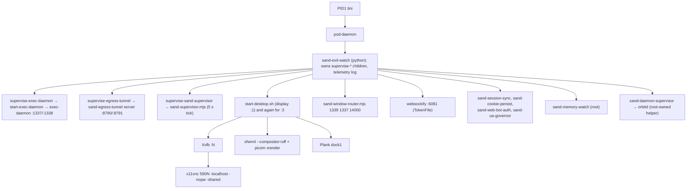
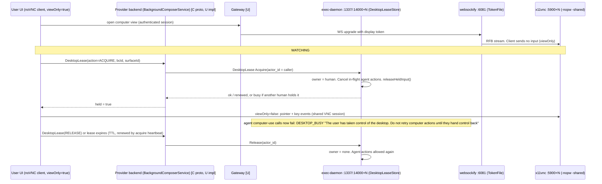
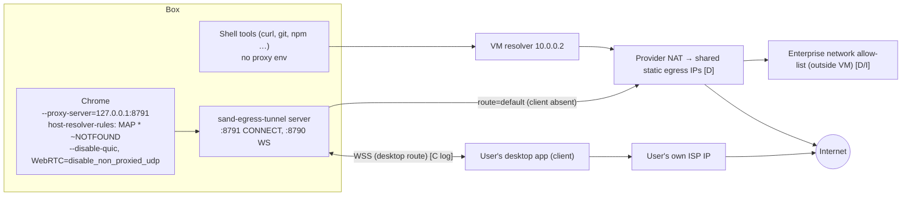
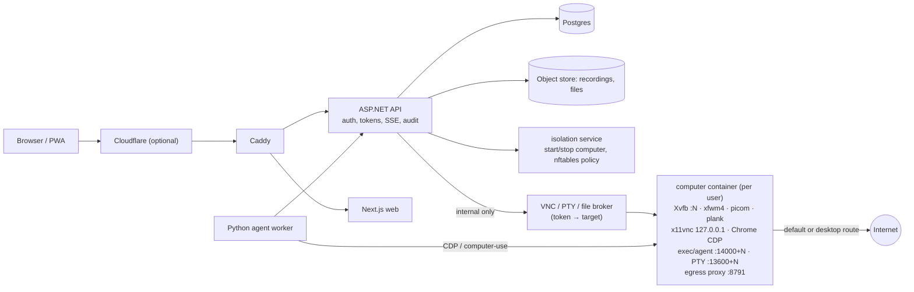

# Bot Computer Architecture (the Grok Bot "box") and how to replicate it in AI Teammates

Scanned: 2026-10-23 (Asia/Karachi), read-only. Nothing on the machine was changed, no other hosts were scanned.
All tokens, bearer values, cookies, keys and non-local IPs are **redacted or not read**. Token files are described by mechanism only.

**Legend** — every claim is tagged:
- **[C]** Confirmed on this machine (process list, `ss`, scripts, config, logs).
- **[D]** Stated in public Cursor/xAI Grok Bot docs (links in section 11).
- **[I]** Inferred (not directly visible from inside the VM). Treat as a design hypothesis.
- **[U]** Unverifiable from inside the VM or from public sources (reason given, safe design supplied).

**Revision 2 (2026-10-23, 10:xx PM Asia/Karachi):** the four INFERRED areas were researched. Results are in **§13 Evidence status** and the affected sections were corrected. Short version:

| # | Item | New status |
|---|---|---|
| 1 | Gateway between app and box, watch/control roles, token flow | Partly **[C]**, rest **[D]/[U]** (§13.1) |
| 2 | Take-control pauses the bot | **[C]** — "Desktop lease" in exec-daemon (§13.2) |
| 3 | Recordings / Teach via ffmpeg | **[C]** (§13.3) |
| 4 | Network allow-list enforced outside the VM | **[D]** + **[C]** that the VM does not enforce it (§13.4) |
| 5 | Production readiness: isolation model and take-control lease | Verdicts in **§16** (isolation: *right principle, not yet production-grade*; lease: *right pattern, ours is closer than the vendor's, 10 fixes needed*) |

---

## 1. One-paragraph summary

The "box" is **one Debian 13 (trixie) Linux microVM per user** [C: `/etc/os-release`, kernel 6.12; D: "dedicated Firecracker microVM"], 8 vCPU / 16 GB RAM / 128 GB durable disk [C]. PID 1 is `tini → /pod-daemon`, which launches a small tree of Node/Python/bash supervisors [C]. The VM **dials out** (the host process holds several outbound HTTPS connections) [C], and the platform exposes only a fixed list of 7 box ports to its gateway: 1337, 1338, 6080, 1339, 6081, 1340, 8790 (`SAND_BOX_EXPOSED_PORTS`) [C]; VNC, CDP and fork ports are never exposed directly. Users never connect to the VM; the provider's servers broker every request [D: "apps send each request to Cursor's servers. From there, work runs on the member's hosted computer"]. Gateway internals are [U] (§13.1). Each "Bot window" is a separate X display (`:1`, `:3`, …) with its own Xvfb, VNC server, Chrome, exec-daemon and PTY, all reachable through two routers (a **window router** for the exec daemon and a **token websockify** for noVNC) [C]. All browser traffic leaves through a local **egress tunnel** (HTTP CONNECT proxy on loopback) that can exit either from the shared datacentre IPs or from the user's own desktop [C+D]. There is **no Cloudflare/Tailscale/WARP software running on the box** [C]; Cloudflare appears only as the *Web Bot Auth* request-signing standard [C: header names `Signature-Agent` / `Signature-Input`; I: that this is Cloudflare's/IETF Web Bot Auth].

> Note: this VM *also* hosts Saad's own AI Teammates docker-compose stack (Caddy on 18080/18443, bridges `br-*`, veth*). Those are **not** part of the box product; they are listed separately in §4.

---

## 2. System map

```mermaid
flowchart LR
  subgraph User["User side"]
    UI["Desktop / mobile app (UI)"]
    DESK["User desktop app\n(egress tunnel client)"]
  end

  subgraph Cloud["Provider cloud (outside the VM)"]
    CP["Control plane + auth\n(api2…)"]
    GW["Per-user gateway / reverse proxy\n(*.cursorvm.com, nested host) [I]"]
    NET["Network policy + shared static egress IPs [D]"]
  end

  subgraph VM["User microVM (Debian 13, Firecracker) [C/D]"]
    direction TB
    POD["tini → pod-daemon (PID1) [C]"]
    WR["sand-window-router :1339 [C]"]
    ED1["exec-daemon :1337 / PTY :1338\n(display :1)"]
    EDN["exec-daemon :14000+N / PTY :13600+N\n(forked display :N)"]
    WS80["websockify :6080 → x11vnc :5900 (no token)"]
    WS81["websockify :6081 (TokenFile) → x11vnc :5900+N"]
    X["Xvfb :N 1920x1200 + xfwm4 + picom + Plank"]
    CH["Chrome CDP :9222+N, kiosk/maximized"]
    TUN["sand-egress-tunnel\nWS :8790 / CONNECT proxy :8791 (loopback)"]
    SUP["sand-supervisor, exit-watch,\nmemory-watch, orbitd"]
    DISK[("/workspace on durable disk")]
  end

  UI -->|HTTPS/WSS| CP
  UI -->|HTTPS/WSS: VNC, PTY, files, CDP| GW
  GW --> WR --> ED1
  WR --> EDN
  GW --> WS81 --> X
  GW --> WS80 --> X
  ED1 --> DISK
  EDN --> CH
  CH -->|--proxy-server loopback:8791| TUN
  TUN -->|default| NET
  TUN <-->|WSS :8790 via gateway, "desktop route"| DESK
  SUP -. restarts / telemetry .-> X
  POD --> SUP
```

---

## 3. Boot and process tree [C]



Patterns worth copying [C]:
- Every long-running process is wrapped by `box-bounded-log` (bash + `flock` + a Node log trimmer) so logs can never fill the disk.
- Each component has a **supervisor with exponential backoff and restart-window limits** (`supervise-exec-daemon`, `supervise-egress-tunnel`, `sand-supervisor-desktop`), writing JSON telemetry lines (`exec_daemon_restart`, `egress_tunnel`, `boot_stage`) to `/tmp/sand-box-telemetry.log`.
- Two cgroups, `interactive` (desktop, Chrome) and `agent` (exec-daemon), same CPU weight, so a runaway agent cannot freeze the live view.
- The exec-daemon is started with `oom_score_adj=-1000` so the OOM killer prefers Chrome.
- `box-doctor` self-test checks: machine-id validity, Chrome version, Chrome open-file-descriptor ratio (fail ≥ 90 %), egress to `generate_204`, clock skew vs. the HTTP `Date` header (fail > 60 s), D-Bus, X display readiness.
- Host-side scripts are shipped as a **versioned "host bundle"** (`/opt/sand/sand-host`, scripts synced into `/usr/local/bin`), so the box can upgrade without re-imaging. Port numbers are generated from one contract (`box-contract.generated.mjs`, `// @generated SignedSource`) into JS and bash so they never drift.

---

## 4. Ports, processes and roles [C unless noted]

### 4.1 Box-product ports

| Port | Bind | Process | Role |
|---|---|---|---|
| 1337 | all | exec-daemon (display :1) | Primary agent API: shell exec, file ops, computer-use, MCP meta tool. Static dev token `local`; reachable only via gateway [I] |
| 1338 | all | exec-daemon | PTY websocket (terminal) |
| 1339 | all | sand-window-router | Routes by header `x-sand-display`: display ≤ 1 → 1337, else → 14000+N after checking `x-sand-window-owner` against a bound token file (constant-time compare). Else 403 |
| 1340 | all | node (host gateway) | "hostGateway" per `box-contract`; internal host↔box channel [C contract; I role] |
| 14000+N / 13600+N | all | exec-daemon/PTY for forked display N (here 14003 / 13603) | Per-window exec + terminal |
| 5900 / 5900+N | **127.0.0.1** | x11vnc `-localhost -nopw -shared -forever -noxdamage` | VNC server per display. No password and **no `-viewonly` flag** |
| 6080 | all | websockify + noVNC web client → 5900 | Plain, **token-less** proxy for the primary display |
| 6081 | all | websockify `--token-plugin TokenFile` | Multi-display noVNC proxy: the client connects with a token and websockify looks up the target `host:port` in `/tmp/sand-novnc-tokens.d` |
| 8790 | all | sand-egress-tunnel server | WebSocket endpoint where a remote *tunnel client* (the user's desktop) attaches |
| 8791 | **127.0.0.1** | sand-egress-tunnel server | HTTP CONNECT proxy that Chrome uses |
| 9222+N (here 9225) | **127.0.0.1** | Chrome `--remote-debugging-port` | CDP for display N (display :1 → 9223, :3 → 9225). `--remote-debugging-address=127.0.0.1` |
| 9400+N | 127.0.0.1 | box-external-view relay | Fake CDP endpoint that forwards to a remote browser WSS (see §7) |
| 9600 | 127.0.0.1 | box-tailnet-chrome | CDP of the optional private-network ("tailnet") browser. Not running now |

### 4.2 Other long-running pieces

| Process | Role |
|---|---|
| `Xvfb :N -screen 0 1920x1200x24 -ac +extension GLX +render -noreset` | Virtual screen. 16:10, same ratio as the 1280×800 `--computer-use-api-width/height` the exec-daemon exposes to the model, so the model's coordinates scale linearly [C+I] |
| `xfwm4 --compositor=off` + `picom --backend xrender` | Window manager + light compositing (no GPU) |
| `plank --name dock1` | Bottom dock. dconf: position bottom, theme Transparent, icon-size 48, hide-mode window-dodge; launchers = Chrome, Thunar, xfce4-terminal. No panel, no desktop icons |
| `sand-wallpaper paint` (hsetroot) | Paints a tone-matched PNG chosen from `~/sand-data/settings.json` (variants `a/b/c`), fallback JPG, fallback solid `#1e2330` |
| `google-chrome-stable` (see §6.3) | The agent's and user's browser |
| `sand-supervisor.mjs` | 5 s tick; host-bundle upgrade logic; probes forked-display VNC with an RFB 003.008 handshake (security type None) and kills/restarts after N failures; restarts desktop components with backoff |
| `sand-exit-watch`, `sand-memory-watch` | Exit reasons and memory pressure telemetry |
| `orbitd` (own user, via `sand-daemon-supervisor`) | Privileged helper reachable by the exec-daemon over a unix socket (`--orbitd-proxy-socket`) |
| `sand-session-sync`, `sand-cookie-persist`, `link-chrome-session` | Persist Chrome session cookies across VM recreation (works around Chrome keeping session cookies in memory only) |
| `sand-web-bot-auth`, `sand-ua-governor` | Browser identity: request signing + UA/fingerprint coherence (§6.3) |
| `cursor-agent-store-fuse` | FUSE mount of the agent store (`/cursor/stores/…`) |
| `browser-use`, `shadcn` MCP servers | Child processes of the primary exec-daemon: MCP servers launched on the box (this is how "plugins" can run locally) [C] |

### 4.3 NOT part of the box product (Saad's stack running on this VM)

`18080`/`18443` (Caddy), `2375`, `50052`, `26500`, Docker bridges `br-*` and `veth*`, 14 containers' NAT (Docker-managed iptables only; all chains ACCEPT). `/workspace/ai-teammates-live/cloudflared.log` shows Saad ran his **own** `cloudflared` quick tunnel earlier; it is not running now [C].

---

## 5. How the user interacts with the box

### 5.1 Functions the box exposes [C = visible on box, D = documented]

| User-visible function | How it works on the box | Evidence |
|---|---|---|
| **Watch** the computer | UI opens noVNC (served from `/usr/share/novnc`) over the gateway to websockify → x11vnc → Xvfb. The client keeps noVNC `viewOnly` on until the server confirms a lease (§13.2) | C (stack + lease RPC doc-comment), D ("Watch the computer") |
| **Take control** | Client calls the `DesktopLease` RPC (acquire). exec-daemon cancels in-flight computer-use actions, releases held keys/buttons and rejects new ones with `DESKTOP_BUSY` until the human releases or the lease expires. Then the client turns `viewOnly` off | **C** (exec-daemon code + host proto), D |
| **Terminal** | PTY websocket (1338 / 13600+N) from exec-daemon, tmux shipped in `/exec-daemon` | C |
| **Files** | `/workspace` on the durable disk (`/dev/vdb`), served by exec-daemon file APIs; upload/download tools move files between user machines and the box | C (disk) / D |
| **Browser** | Chrome with CDP on loopback; used by Playwright/browser-use/MCP and by computer-use screenshots | C |
| **Computer use** | exec-daemon flags `--computer-use-enabled --computer-use-lazy-init --computer-use-api-width 1280 --computer-use-api-height 800`; request message `ComputerUseArgs` has `actions[]`, `desktop_lease_actor_id`, `screenshot_settle_ms`, `native_x11_driver`, `mark_monitor_busy`, `full_resolution_screenshot`; screenshots via `ffmpeg x11grab → libwebp` scaled to the 1280×800 model size | C |
| **Recordings / Teach a task** | Teach: host service runs `ffmpeg -f x11grab … -framerate 15 -t 600 -c:v libx264 -preset ultrafast -an demo.mp4` on the bot's private fork display; the result is queued and the bot is prompted "The recording is finished. Learn the task from it." Action recordings use a separate ffmpeg path (§13.3) | **C**, D |
| **Plugins / MCP** | MCP servers are spawned as children of exec-daemon (`browser-use`, `shadcn` seen); `--mcp-meta-tool-enabled` | C |
| **Shell approvals / Auto Review** | Not implemented in the box scripts. Per docs it is an independent review model in the provider backend that evaluates shell, app, computer-use and delegation actions before they run. The box only carries team settings (`sand_auto_review_*` fields in the host proto) | D, C (settings schema), U (enforcement point) |
| **Sign-in hand-off** | Bot never types passwords; user takes control and signs in; session cookies persist (sand-cookie-persist) | D, C |
| **Reset / Recover / hibernate** | Durable disk survives; VM recreated from last saved data | D |

### 5.2 Watch → Take control flow [C unless tagged]



**View-only vs read-write, now confirmed [C]:**
- x11vnc has **no** `-viewonly`, no password, no `-viewpasswd`; the VNC server itself accepts input from any client that reaches it. noVNC's `RFB.viewOnly` property ("any events … should be prevented from being sent to the server") is the only per-client input filter (client-side) [C + D: noVNC API].
- The provider's RPC doc-comment states: *"Take or release the exec-daemon desktop lease … so a human can drive the Cloud Desktop without the agent's input landing. Authenticated users only; the actor is always the caller. **Callers must stay view-only until `held` is true.**"* [C: host proto]. So the UI-side mode switch is gated on the server-side lease acknowledgement.
- The lease **fences the agent, not the human**. It guarantees agent and human never type at the same time. It does not (on the box) stop a hostile client with raw VNC access from sending input while "watching". A server-enforced read-only VNC role is **[U]**: nothing on the box does it; if the gateway does, it is not visible. Safe design for AI Teammates in §13.1.

### 5.3 noVNC token mechanism (no values shown) [C]

- `/tmp/sand-novnc-tokens.d/` holds one tiny file per display. File name = the token; content = one line `token: host:port` (the standard websockify `TokenFile` format).
- `start-desktop.sh` writes that file when `SAND_NOVNC_TOKEN` is set in the environment (the host injects it at window creation); otherwise it starts a plain websockify without tokens (this is the `:6080` primary path).
- websockify reads the directory on every connection, so adding/removing a file instantly grants/revokes a route with no restart.
- On this box the tokens are **short routing keys**, not strong secrets. Security therefore relies on the network position: the gateway is the only party able to reach 6081 [I]. Do not copy that detail; use random ≥128-bit tokens with a TTL if the port is ever reachable by users.
- Second token directory: `/tmp/sand-window-tokens.d/` binds a window owner token to a display for the **window router** (header check, `timingSafeEqual`, 403 on mismatch) [C]. A third dir `/tmp/sand-window-used.d/` is **not** a one-time-token store: the router touches a per-display marker every 15 s while requests are in flight (`.inflight` suffix) so other components know the display is in use; stale markers are cleared at router start [C].

---

## 6. IP, DNS, egress and Cloudflare

### 6.1 Egress flow



Confirmed facts [C]:
- Chrome is started with `--proxy-server` pointing at the loopback CONNECT proxy and `--host-resolver-rules="MAP * ~NOTFOUND , EXCLUDE localhost , EXCLUDE 127.0.0.1 , EXCLUDE ::1"`. Chrome therefore **never does DNS itself**; hostnames are resolved by whoever terminates the tunnel. That avoids DNS leaks and makes the browser look like it lives where the exit IP is.
- Shell traffic (`curl` etc.) has **no proxy variables** and uses the VM's resolver `10.0.0.2` and the default route (direct NAT). So browser and shell can have different exit IPs.
- `/tmp/sand-egress-tunnel-client` marker exists and `egress-tunnel.log` shows `route="desktop"`, `fail_closed=false`, `desktop connect` / `desktop disconnect … grace_s=90` and `client attached to a vacant tunnel session`. Meaning: a client on the user's desktop attaches over the WS port, there's a 90 s grace window on disconnect, and with `fail_closed=false` the box falls back to the normal route when no client is attached. A marker `/tmp/sand-egress-tunnel-fail-closed` switches to fail-closed [C contract]. Docs call this "Route traffic through this computer" / Allow Local Egress Routing (Enterprise gate) [D].
- Fingerprint hygiene markers set at boot: `webrtc-proxy-only`, `no-local-dns`, `disable-quic`, `browser-egress-timezone`, `accept-language-en-us`, `coherent-fingerprint`, `hardware-profile`, GPU mode (`swiftshader`). `sand-egress-timezone.mjs` looks up the exit IP's country/timezone via two public geo APIs (ipinfo, ipwho.is), and the browser timezone/locale is set to match. `sand-ua-governor` overrides UA/WebGL/canvas via CDP so they are internally consistent. `--disable-blink-features=AutomationControlled` is set.
- iptables/nft (read-only view): only Docker NAT masquerade rules; default policies ACCEPT. The VM does **not** enforce an egress allow-list [C]. The egress tunnel binary contains no allow-list/deny-list strings, only an SSRF guard (`ssrf::is_blocked`, "resolves only to blocked address") that refuses private/loopback targets [C]. Enterprise Network Controls (modes Allow all / Defaults + team allowlist / Team allowlist only, entries of domain, wildcard, IP, CIDR or host:port (vendor: no cap; ours is a configurable limit)) are enforced **outside the VM** [D]; where exactly is [U] (§13.4).
- **No** `cloudflared`, `warp-cli`, `tailscale`, `wg` binary or process exists on the box [C].
- **TEAMS-ISO**: the string does not occur in any box script or `/etc` file [C]. It is probably a dashboard/plan label or the ISO 27001/42001 certification referenced in the docs [D]; treat as unverified. A team-managed setup exists: `/opt/sand-managed/assignment.json` + `sand-team-converge.mjs` (Team Setup Scripts: manifest-driven installs, secrets envelope with reserved env prefixes `SAND_`, `LD_`, `__CURSOR`). Contents were **not** read.

### 6.2 "Tailnet" / private network path [C code, not provisioned now]

- `box-tailnet-chrome` launches a **second Chrome** (CDP 9600) whose profile, home, downloads and XDG dirs live in a **RAM-only tmpfs** at `~/tailnet`; it refuses to start if that folder is not tmpfs, or if the box is an "untrusted-turn clone" (exit 75).
- `sand-tailnet-mount` (root, Python) mounts that tmpfs race-free (`O_NOFOLLOW` dir fd + `mount --no-canonicalize`); `sand-tailnet-wipe` clears it; a host list `/var/lib/sand/tailnet/host-suffixes` tells the everyday browser to **block** private-network hostnames so they can only be opened in the tailnet browser.
- The route to the private network itself is host-side (no VPN client in the VM). Docs: Tailscale/Cloudflare-Tunnel recipes are for Cloud Agents; for Grok Bot you route through the member's desktop or install your own client via Team Setup Scripts [D].

### 6.3 Cloudflare relevance

- **Web Bot Auth** [C code, I standard]: `sand-web-bot-auth.mjs` enables the CDP `Fetch` domain on Chrome and adds `Signature-Agent` and `Signature-Input` (+ signature) headers to outgoing requests, with a 120 s signed-header cache (`/tmp/sand-web-bot-auth-signed.json`, max 64 entries) and signature sources `fresh | box_cache | fleet_cache`. This matches Cloudflare's **Web Bot Auth** [D: developers.cloudflare.com/bots/reference/bot-verification/web-bot-auth, IETF `draft-ietf-webbotauth-httpsig-protocol-00`, 1 Sep 2026, authors Cloudflare + Google]: bots sign requests with Ed25519 HTTP Message Signatures, publish a JWKS key directory at `/.well-known/http-message-signatures-directory`, register it with Cloudflare, then send `Signature-Agent`, `Signature-Input` (`tag="web-bot-auth"`, `keyid`, `created`, `expires`, components `@authority` + `signature-agent`) and `Signature`. The box's signature sources are `fresh | box_cache | fleet_cache`, so the signing key is most likely held by a provider service, not on the box [I, no key file found among readable files]. Cloudflare's production still implements directory draft -03 (note: Signature-Agent must be a quoted HTTPS URI) [D: cloudflare-docs issue #30968].
- Because exit IPs are shared datacentre ranges, sites flag them [D]; mitigations are: signed requests, fingerprint coherence, and routing through the user's home IP.
- For **user → box** access there is no Cloudflare in the VM; the public edge is the provider's gateway [D: `*.cursorvm.com` nested hostnames, TLS-inspecting proxies must be exempted].

### 6.4 External view (remote cloud browser inside the desktop) [C]

`box-external-view start N` reads one JSON line `{connectUrl: wss://…, liveViewUrl: https://…}` on stdin, then:
1. opens a Chrome **kiosk** window (WM class `sand-external-view`) on display N showing a 36 px status bar + an iframe of `liveViewUrl` (CSP restricted to https/loopback);
2. starts a relay on `127.0.0.1:9400+N` that serves a fake `/json/version` whose `webSocketDebuggerUrl` is `/devtools/browser/external`, and pipes that WebSocket to the remote `connectUrl` (through the egress proxy unless loopback), max 8 connections, rejects any request with an `Origin` header or non-loopback `Host` (DNS-rebinding defence);
3. accepts `{kind:"navigate", liveViewUrl}` commands and reports `disconnected`; restarts the viewer once.
Result: the agent's CDP tools drive a remote hosted browser while the user's VNC view shows its live view. Exit codes: ok 0, failed 1, usage 64, unavailable 69, busy 73.

---

## 7. How the user's UI connects [mostly I]

1. UI authenticates to the provider control plane (account SSO) → gets session.
2. UI asks for the user's computer; the control plane wakes/starts the microVM if hibernated (D: "idle computers hibernate").
3. UI opens separate WebSockets through the gateway: chat/events (control plane), noVNC (→ 6081/6080), PTY (→ 1338 or 13600+N), exec/file/computer-use requests (→ 1339 → 1337/14000+N), screenshots/CDP as needed.
4. The VM itself only has **outbound** connections (pod-daemon uses a vsock SSH-agent socket; orbitd/host bundle fetched from a gateway). `ss` shows no remote client directly attached to 6080/6081 other than local relays [C].
5. Mobile and desktop apps use the same flow; "Route traffic through this computer" starts the tunnel client in the desktop app and attaches to the WS port (§6.1) [D+C].

---

## 8. What the desktop looks like (matches the screenshot) [C]

Debian 13 · Xvfb 1920×1200×24 · xfwm4 (compositor off) + picom xrender · **Plank** bottom dock (3 icons: Chrome, Thunar, Terminal; Transparent theme; 48 px; window-dodge hide) · no panel / no desktop icons · dark-grey swoosh wallpaper via `hsetroot -cover` · GTK file-chooser sized 1100×680 at (90,60) · default browser forced to `box-chrome.desktop`. The "Watching | Take control" pill and the rounded 16:10 frame are in the **web UI**, not the VM [I].

---

## 9. Security design notes (what to copy, what not to) [C]

- Secrets are scrubbed from children: `start-desktop.sh` unsets the gateway token and tunnel bearer from its env **and from any env var whose value contains them**; Chrome and the exec-daemon are launched with those unset (`env -u …`). A unix socket `sand-identity.sock` (mode 0600) provides identity instead of env tokens.
- Everything runs as non-root user `box`; root-only helpers (`orbitd`, memory-watch, tailnet mount) are separate small programs.
- Chrome runs `--no-sandbox` (VM is the sandbox), `--password-store=basic`, with managed policies for WebRTC (`disable_non_proxied_udp`) and force-installed WebAuthn/1Password extension shims.
- Ports 6080/6081/1337/1338/8790 bind on `0.0.0.0` with weak/no auth. This is safe only because the VM has no inbound route from the internet. **Do not copy that**: in Docker, publish nothing and authenticate at the API.
- Window forks are cross-checked: `x-sand-window-owner` must equal the token bound to that display, else 403.

---

## 10. How to replicate in AI Teammates (summary table; build order and acceptance tests are in §14)

Current state (from `src/services/computer`): Debian trixie-slim, Xvfb at **1024×768**, openbox + tint2 + pcmanfm, x11vnc, noVNC on 6080, a small in-container agent on 7700, compose services `caddy, web, api, agent, computer-image, docker-proxy, isolation, postgres, object-store`, Caddy routes `/api/*`, `/api/events`, `/vnc/*` to the API. This is already structurally close. Gaps and steps, in priority order. Effort = one developer, includes tests.

| # | Step | Concrete work | Effort |
|---|---|---|---|
| 1 | **Match the desktop** | Replace openbox/tint2 with `xfwm4 --compositor=off` + `picom --backend xrender` + `plank` (dconf: bottom, Transparent, 48 px, window-dodge; 3 launchers); Xvfb `1920x1200x24`; `hsetroot` wallpaper (our own swoosh PNG); set `DISPLAY_GEOMETRY`/`SCREEN_*` env; computer-use API size 1280×800 with coordinate scaling ×1.5 | 1–1.5 d |
| 2 | **One generated port contract** | `contracts/box-contract.json` → generated TS/C#/bash/py constants (like `box-contract.generated.mjs`). Bases: exec 14000+N, pty 13600+N, vnc 5900+N, cdp 9222+N | 0.5 d |
| 3 | **Multi-window per computer** | `start-window N` / `stop-window N` scripts: own Xvfb `:N`, x11vnc `-localhost`, Chrome with `--remote-debugging-port=9222+N`, agent worker; cap with `MAX_WINDOWS`; one window per bot | 2 d |
| 4 | **VNC broker with roles** | In ASP.NET API: `/vnc/{botId}?role=watch|control` → issues a short-lived (≤60 s), single-use, random 128-bit token. Tiny websockify-style proxy (can be a Go/Node sidecar or `websockify --token-plugin` reading a tmpfs dir that the API writes through the isolation service). **Watch role: drop RFB client messages 4 (Key) and 5 (Pointer)** server-side, not only in the UI; control role passes everything. Keep x11vnc on `127.0.0.1`, no published ports | 2 d |
| 5 | **Take-control state machine** | `computer.mode` = `bot | user` per window, stored in Postgres + SSE event; when `user`, agent worker refuses computer-use actions ("paused") and the working row shows "You're in control"; Stop returns to `bot`. Audit each switch in the existing AuditChain | 1.5 d |
| 6 | **Window router** | Small proxy in the container (or in API) that maps `X-Display` + owner token → port, constant-time compare, 403 otherwise. Needed only if one container hosts several windows | 1 d |
| 7 | **Supervisors + health** | s6 already exists: add backoff/restart-window limits, `box-bounded-log` equivalent (logrotate or Node trimmer), RFB handshake probe (`RFB 003.008`, security type None, ServerInit read) every 5 s, cgroup `interactive` vs `agent` weights, `box-doctor` script exposed at `/internal/computer/{id}/doctor` | 2 d |
| 8 | **Egress tunnel** | Per-computer HTTP CONNECT proxy on `127.0.0.1:8791` (Go/Rust/Node). Chrome flags: `--proxy-server`, `--host-resolver-rules="MAP * ~NOTFOUND , EXCLUDE localhost , EXCLUDE 127.0.0.1"`, `--disable-quic`, WebRTC policy. Two exits: **default** (Docker NAT, optional per-tenant allow-list enforced in the `isolation` service/nftables on the Docker bridge) and **desktop route** (a client in the companion app opens a WSS to the API, which splices CONNECT streams; 90 s reconnect grace; `fail_closed` flag). Align browser TZ/locale to exit-IP geo | 4–5 d |
| 9 | **Network policy** | Per-team allow-list (domains + CIDR:port) applied at the egress proxy and, for raw TCP, at an nftables set on the compute bridge; show "blocked by policy: add host" errors | 2 d |
| 10 | **Terminal + files** | PTY websocket per window (node-pty or `ttyd`) reachable via API proxy with the same token scheme; file API under `/workspace` with upload/download, path jail, size limits | 2 d |
| 11 | **Recordings / Teach** | Per-window `ffmpeg -f x11grab -framerate 5 -i :N` (VP9/H.264, 10 min cap, no audio) → object-store; Teach banner state in UI; on stop post "The recording is finished. Learn the task from it." with the file attached | 2 d |
| 12 | **Browser identity (optional)** | Implement Web Bot Auth signing in API (Ed25519 key per tenant, publish `/.well-known/http-message-signatures-directory`), CDP `Fetch.enable` hook in the worker adds `Signature-Agent`/`Signature-Input`/`Signature`; UA/WebGL coherence | 2–3 d |
| 13 | **Private network (optional)** | Tailnet-style second browser with RAM-only profile (`tmpfs`), host-suffix block-list in the normal browser; route via the desktop route or an operator-supplied WireGuard/Tailscale sidecar | 3 d |
| 14 | **Public edge** | Keep Caddy; add `cloudflared` (named tunnel, outbound only) or Cloudflare proxy in front for TLS/WAF; WebSocket idle timeouts ≥ 100 s need heartbeats (websockify `--heartbeat=30` is the reference). Don't publish 6080/5900 | 0.5–1 d |
| 15 | **Approvals / Auto Review** | Keep in API: tool-call gate with Allow once / Always / Deny, relayed to all chats (already in V0.4 messaging); rules stored per user | existing |

Total for 1–11 ≈ 18–20 dev-days; 12–14 optional ≈ 6–7 days.

Suggested compose layout:



---

## 11. Sources (original scan)

Machine (all read-only): `/usr/local/bin/{box-contract.generated.mjs, box-x11vnc, box-doctor, box-external-view*, box-tailnet-chrome, box-chrome, box-chrome-policy, start-desktop.sh, start-window, supervise-*, sand-window-router.mjs, sand-supervisor*.mjs, sand-web-bot-auth.mjs, sand-egress-timezone.mjs, sand-wallpaper, sand-tailnet-*}`, `ss -tlnp`, `ps`, `ip`, `/proc/<pid>/cmdline` of Chrome/exec-daemon (secret values stripped), `/tmp/egress-tunnel.log`, `/tmp/sand-box-telemetry.log`, `/usr/share/novnc`.

Public docs:
- Security FAQ: https://cursor.com/docs/grok-bot/security-faq
- Security (network policy, static egress IPs, approvals, local execution): https://cursor.com/docs/grok-bot/security
- Work with Grok Bot (watch, take over, files, Teach a task): https://cursor.com/docs/grok-bot/work
- Connect to private networks: https://cursor.com/docs/grok-bot/private-networks
- Settings (route traffic through your desktop): https://cursor.com/docs/grok-bot/settings.md
- Use the computer and apps: https://docs.x.ai/grok-bot/computer-and-apps

## 12. Still unverifiable after research [U]

| Item | Why it cannot be verified | Safe assumption |
|---|---|---|
| Gateway implementation (hostnames, WS auth, whether the 6081 token is per-session or per-window, whether a view-only role is enforced server-side) | Runs outside the VM; the VM has no gateway config readable without opening credential files (`gateway.json` was deliberately not read); no public doc describes it | Treat as an authenticating reverse proxy that forwards only the 7 exposed ports |
| Where Auto Review runs | Only the settings schema is on the box | Backend, before the tool call reaches exec-daemon |
| Where the network allow-list is enforced | No firewall/proxy rules in the VM; only docs | Provider network layer (NAT/egress proxy) per computer, applied "within about a minute" |
| Web Bot Auth key custody | No key material among readable files; `fleet_cache` implies a service | Provider-held Ed25519 key, published directory |
| "TEAMS-ISO" | String not present on the box; docs mention ISO/IEC 27001 + 42001 (Schellman) for the company | A label outside the VM, not a network object |

---

## 13. Evidence status for the four inferred areas

### 13.1 Gateway, roles, token flow, noVNC proxy, external view, exec-daemon

| Claim | Status | Evidence |
|---|---|---|
| The platform reaches the box on exactly 7 ports (1337, 1338, 6080, 1339, 6081, 1340, 8790); VNC (59xx), CDP (92xx), relay (94xx), exec forks (14xxx) are never exposed | **C** | `SAND_BOX_EXPOSED_PORTS` in the host bundle (`/opt/sand/sand-host/host-main.cjs`, generated from `box-contract.ts`) |
| The VM dials out (not just listens) | **C** | host process (pid owns 1340) has 6 established outbound connections; `pod-daemon` uses vsock ssh-agent |
| Port 1340 = "hostGateway" is served by the host Node process (`host-main.cjs`), 1339 by the window router, 1337 by exec-daemon | **C** | `ss -tlnp` owner pid ↔ `ps` command line |
| Window router: header `x-sand-display` selects display, `x-sand-window-owner` must equal the token bound in `/tmp/sand-window-tokens.d`, constant-time compare, 403 otherwise | **C** | `sand-window-router.mjs` |
| websockify 6081 maps token → `localhost:590N` from a directory; 6080 is a fixed target to 5900 | **C** | process args + websockify TokenFile semantics [D: websockify docs] |
| noVNC enforces "view only" in the **client** (`RFB.viewOnly`) | **C/D** | `/usr/share/novnc/core/rfb.js` + noVNC API doc |
| x11vnc has no `-viewonly`, so the VNC server itself is read-write for anyone who reaches it | **C** | x11vnc command line (no `-viewonly`, `-nopw`) [D: x11vnc man: "-viewonly: all VNC clients can only watch (default off)", "-viewpasswd: 2nd password for view-only logins"] |
| UI must stay view-only until the backend returns `held=true`; backend RPC `BackgroundComposerService.DesktopLease` forwards to the exec-daemon | **C** | doc-comment of the RPC in the host proto |
| The 6081 token is a routing key, not a strong secret | **C** (mechanism) | token file content = `token: host:port` |
| exec-daemon (`/exec-daemon/index.js`, 5 MB bundle, Node SEA tree) serves Connect/gRPC-style RPCs (`ControlService`: Exec, ListDirectory, Read/WriteTextFile, Read/WriteBinaryFile, ComputerUse, DesktopLease, ReloadPlugins, LoadMcpServers, SyncScopedSecrets, GetResourceUsage…), PTY WebSocket, tmux | **C** | service/method names in the bundle and host proto |
| `box-external-view` = kiosk Chrome + loopback CDP relay to a remote browser's `connectUrl` | **C** | `box-external-view*.mjs/.html` |
| Gateway hostnames and auth (`*.cursorvm.com`) | **D** | docs note on TLS-inspecting proxies; hostname patterns only |
| Server-enforced read-only VNC role | **U** | not on the box |

**Safe design for AI Teammates (since the real gateway is unverifiable):** make the API the only authenticator. Issue a random 128-bit, single-use, ≤60 s ticket per WebSocket (`/vnc/{window}?role=watch|control`), bind it to (user, bot, window, role, IP-hash). A small broker (not the browser) opens the upstream to x11vnc on the private Docker network and, for `watch`, **parses RFB and drops client→server message types 4 (KeyEvent), 5 (PointerEvent), 6 (ClientCutText)**. `control` additionally requires an active lease (§13.2). x11vnc keeps `-localhost`/internal-network-only. Defence in depth: add x11vnc `-viewpasswd` as a second, server-side gate if a direct path ever exists.

### 13.2 Take-control pausing the bot's actions — **CONFIRMED**

Evidence (exec-daemon `DesktopLeaseStore`, host proto, feature flag text):
- Feature flag text in the host bundle: *"Cloud Desktop lease: humans taking control fence computer-use input on the VM, and computer-use subagents stamp their actions. Assignment unit: userID. Off keeps the legacy client-only takeover."* So there was an earlier **client-only** takeover; the lease is the server-side fence.
- RPCs `DesktopLeaseAcquire`, `DesktopLeaseRelease`, `DesktopLeaseGetState`, `DesktopLeaseOwner`, `DesktopLeaseResponse`; actor kinds human/agent; statuses ok/busy/invalid; each `ComputerUseArgs` carries `desktop_lease_actor_id`.
- Logic: `acquire(actor)`: empty id → invalid; same actor → renew TTL; another human holds → `busy`; otherwise owner=human, **cancel all in-flight computer actions** (drain timeout 2 s), **release held keys/buttons**. `authorize(agentActor)`: if a human owns → throw `DESKTOP_BUSY` with message *"The user has taken control of the desktop. Do not retry computer actions until they hand control back; wait or report back to the user."*; if another agent actor owns → `agent_held`; otherwise grants/renews an **agent lease with 90 s TTL**; unstamped calls are allowed unless `desktopLeaseEnforce` is on (default off, controlled by the daemon flag / feature flag). Metrics count allow/reject by reason.
- The agent sees `DESKTOP_BUSY` as a tool error and is told to wait or report back, which is exactly the "Take over for sensitive steps → tell the Bot to continue" flow in the docs [D].

**For AI Teammates:** implement as a small `DesktopLease` state in the computer service (`services/computer/src/server.py`) plus an API route; see §14 step 5.

### 13.3 Recordings and Teach via ffmpeg — **CONFIRMED**

- `ffmpeg`, `xdotool`, `wmctrl` are installed (`/usr/bin`) [C].
- **Teach a task** (host extension `teach-recording-service`): allowed only on a **fork window** ("Teach recording requires a private desktop monitor"). Starts on the bot's display:
  `ffmpeg -y -v error -f x11grab <video_size/-i :N> -framerate 15 -t 600 -c:v libx264 -preset ultrafast -g 75 -pix_fmt yuv420p -an …/demo.mp4`, `nohup` in background, PID in `ffmpeg.pid`, log in `ffmpeg.log`, metadata in `session.json` (`startedAt`, `display`, `maxDurationMs` = 600000, `videoPath`, `ffmpegPid`, `endedAt`, `endReason`). Folder: `/workspace/teach-sessions/teach-<UTC stamp>-<uuid>/` [C: host bundle + an existing session folder with 10 s demo metadata, ffmpeg.log empty, i.e. clean exit].
- On stop/cap, the session is queued under `/workspace/teach-sessions/queues/<hash>/pending/…json` (claimed → `claimed/`, `.prompt-delivered` marker, HMAC-style queue key file not read) and the bot is sent the persisted prompt **"The recording is finished. Learn the task from it."**, which activates the managed skill `learn-from-demonstration` [C]. Microphone is not recorded (`-an`) [C+D].
- **Action/agent screen recordings** (`RecordScreen` tool, `LocalRecordScreenExecutor` in exec-daemon): `ffmpeg -f x11grab -framerate <refresh,default 60> -draw_mouse 0 … -vf scale=1920:-2:lanczos,fps=60 -c:v libx264 -preset veryfast -crf 17 -pix_fmt yuv420p -profile:v high -x264-params keyint=1:min-keyint=1:scenecut=0:bframes=0 -movflags +faststart -tune fastdecode …/recording_render_proxy_1080p.mp4` (all-intra proxy for fast seeking), then a "polished recording render" pipeline (render plan from `recording-data.json`, optional brand tag) [C].
- **Screenshots** for computer use: `ffmpeg -f x11grab -frames:v 1 [-vf scale=1280:800] -c:v libwebp -lossless 1 -f webp pipe:1` [C].

**For AI Teammates:** ready-to-copy ffmpeg command lines above; step 11.

### 13.4 Network allow-lists / egress enforcement outside the VM — **DOCUMENTED + C (negative)**

- Documented [D: cursor.com/docs/grok-bot/security#network-policy, /teams, /private-networks]: Network Controls is **Enterprise only**; modes *Allow All* (default), *Defaults + Team Allowlist*, *Team Allowlist Only*; destinations = domains, wildcard domains, IPs/CIDR, `host-or-CIDR:port`; no vendor-stated cap on entries (the current security page says there is no cap, see §16; ours is a configurable limit); directory-group policies override the team's unless locked; applied to running computers "within about a minute", sleeping computers on wake; separate from Cloud Agent network settings; **Apply to MCP servers** switch makes remote MCP connectors obey the list (they run from Cursor's servers, not the VM) and refuses with *"MCP server … refused: it is not on your team's Grok Bot network allowlist"*. Admin API `GET/PUT https://api.cursor.com/grok-bot/network` with `egressMode ∈ {unset, allow_all, default_with_network_settings, network_settings_only}` per a third-party how-to (METAGROK, 2026-10-23), which also claims policy applies on create/recreate, conflicting with the official "within about a minute"; treat the official docs as authoritative.
- Confirmed on the box [C]: team settings schema `SandNetworkControls{egress_mode, allowlist[], locked, apply_allowlist_to_mcp}` and `SandLocalEgressControls` exist in the host proto (so the **client/host knows** the policy), enum `SandEgressMode = ALLOW_ALL | DEFAULT_WITH_NETWORK_SETTINGS | NETWORK_SETTINGS_ONLY`. The VM has **no** matching firewall/proxy rule: nft/iptables hold only Docker masquerade; the egress tunnel has an SSRF guard but no allow-list. Therefore enforcement is outside the guest (provider NAT/egress proxy) [D + C negative]. The exact component is **[U]**.
- Unrelated but similar names seen in the host bundle: `NetworkPolicy{allow[], deny[]}` and `networkPolicyStrict` in the **local command sandbox** (`cursorsandbox --policy …`) used when commands run on a user's own machine, not on the cloud computer [C].
- Shared static egress IPs, no dedicated per-customer IP, US region [D].

**Safe design for AI Teammates:** enforce in two places that you control: (1) the per-computer egress proxy (§14 step 8) matches CONNECT host/port against the allow-list (domain, wildcard, CIDR, host:port) and returns 403 with a clear reason, logging every decision to the audit chain; (2) an nftables set on the compute Docker bridge drops everything except the proxy and DNS for `team_allowlist_only` so raw sockets cannot bypass it. Apply by pushing a versioned policy to the proxy (hot reload) so no restart is needed. If MCP/connectors run server-side, check the same list in the API before dialing.

---

## 14. Implementation checklist for AI Teammates (all 15 steps, build order)

Conventions: "NEW" = file/service to create; other paths exist today in `src/`. Each step must pass its acceptance tests before the next starts. Effort = one developer. Step numbers match §10; the **order** is by dependency.

| Order | Step | Files / services to change | Acceptance tests | Effort |
|---|---|---|---|---|
| 1 | **#2 Port contract** | NEW `contracts/box-contract.json`; NEW `scripts/gen-box-contract.mjs` → emits `apps/api/BoxContract.g.cs`, `services/computer/src/box_contract.py`, `services/computer/scripts/box-contract.sh`, `apps/web/lib/box-contract.ts`; CI check `make contract-check` | Generated files have a `@generated` header; CI fails if regenerated output differs; unit test: port(display N) = 5900+N / 14000+N / 13600+N / 9222+N for N=1..8; no hard-coded port literals left (grep gate) | 0.5 d |
| 2 | **#1 Match the desktop** | `services/computer/Dockerfile` (add xfwm4, picom, plank, hsetroot, dconf; remove openbox/tint2 and `DISPLAY_GEOMETRY=1024x768`); `desktop/start-wm` → xfwm4 `--compositor=off`; NEW `desktop/start-picom`, `desktop/start-dock` + dconf for Plank (bottom, Transparent, 48 px, window-dodge, 3 launchers); `desktop/wallpaper.svg` → PNG via `hsetroot -cover`; `s6/s6-rc.d` units; `services/agent/browser.py` + `grounding.py` scale 1920×1200 ↔ 1280×800 | Screenshot test shows 1920×1200; dock visible with 3 launchers; compositor off (`xprop`); click at model (640,400) hits screen (960,600); e2e `tests/e2e` visual diff ≤ 2 % vs. golden | 1–1.5 d |
| 3 | **#3 Multi-window per computer** | `services/computer/src/desktops.py` (create/destroy display N: Xvfb, x11vnc `-localhost`, Chrome with `--remote-debugging-port=9222+N`, agent worker); NEW `scripts/start-window`, `stop-window`; `apps/api/Teammates…` window table + `MAX_WINDOWS`; `services/computer/src/cdp_proxy.py` maps window → CDP | Create 3 windows concurrently: 3 distinct Xvfb/VNC/CDP ports, no collisions; destroying one leaves others running; 9th window request rejected with 409; restart of container restores windows | 2 d |
| 4 | **#7 Supervisors + health** | `services/computer/s6/s6-rc.d/*` (backoff, restart window caps); NEW `scripts/box-bounded-log`; NEW `src/doctor.py` (checks: machine-id, Chrome up, FD ratio < 90 %, egress `generate_204`, clock skew < 60 s, display ready, RFB handshake); NEW `src/supervisor.py` (5 s tick, `status.json`, RFB 003.008 probe with failure threshold); cgroup split `interactive`/`agent` in `deploy/compose.production.yml`; `apps/api/Reliability.cs` exposes `/internal/computer/{id}/doctor` | Kill Xvfb: supervisor restarts it within 15 s and `status.json` records it; flood logs 1 GB: log dir stays ≤ cap; CPU-hog in `agent` cgroup keeps VNC frame rate above 10 fps; doctor returns structured JSON with each check, and fails on a seeded clock skew | 2 d |
| 5 | **#6 Window router** | NEW `services/computer/src/window_router.py` (or Caddy matcher if one container per window); header `X-Display` + `X-Window-Owner`; token dir tmpfs; constant-time compare; liveness markers touched every 15 s | Wrong owner token → 403 and no upstream call; right token routes to 14000+N; timing test: mismatch time independent of prefix length (±5 %); display 1 maps to primary port | 1 d |
| 6 | **#14 Public edge** | `deploy/Caddyfile.production` (keep `/vnc/*`, `/api/events` flush; add WS timeouts and heartbeat; no 5900/6080 publish); optional `cloudflared` service in `deploy/compose.production.yml` (named tunnel, outbound only) + Cloudflare Access policy for `/admin`; security headers; `compose.test.yml` unchanged | `nmap` of the host shows only 80/443 (or none with tunnel); WS stays alive 10 min idle with heartbeat; `/internal/*` and `/metrics` return 404 externally; Cloudflare Access blocks unauthenticated `/admin` | 0.5–1 d |
| 7 | **#4 VNC broker with roles** | NEW `services/computer/src/vnc_broker.py` (or sidecar): ticket validation, RFB message filter for watch; `apps/api/Routes.cs` `POST /api/computers/{id}/vnc-ticket?role=watch|control`; `apps/api/Security.cs` ticket store (single-use, 60 s, bound to user+bot+window+role); `apps/web/components/ComputerView.tsx` NEW (noVNC with `viewOnly`) | Replay a used ticket → 401; ticket for window A used on B → 403; `watch` role: injected KeyEvent/PointerEvent frames never reach x11vnc (assert via `xinput test`/xdotool log: zero events); `control` without lease → 409; ticket expiry after 60 s | 2 d |
| 8 | **#5 Take-control state machine (DesktopLease)** | `services/computer/src/server.py`: `DesktopLease{acquire,release,state}` with agent TTL 90 s, human TTL (e.g. 120 s, renewed by heartbeat), cancel in-flight actions (2 s drain), release held keys; `services/agent/worker.py` + `guard.py` stamp `actor_id` on computer actions and handle `DESKTOP_BUSY` by pausing and posting "You're in control — tell me when to continue"; `apps/api` routes `POST /api/computers/{id}/lease`; SSE event `computer.mode`; `apps/api/AuditChain.cs` log acquire/release; web pill Watching ↔ Take control | While human holds lease: agent click returns `DESKTOP_BUSY` within 200 ms and is not retried; in-flight action cancelled < 2 s; held modifier keys released; human lease expires without heartbeat; second human gets `busy`; releasing resumes the bot after the user's "continue"; audit chain contains both events | 1.5 d |
| 9 | **#10 Terminal + files** | NEW `services/computer/src/pty.py` (PTY per window via `ptyprocess`/ttyd, ticket auth); `apps/api/BotFs.cs` (upload/download with path jail under `/workspace`, size caps, content-type sniffing); `apps/api/Dlp.cs` scan on download; web terminal component (xterm.js) | `../` traversal blocked; symlink escape blocked; 100 MB cap enforced; terminal survives 5 min idle and reconnects to same tmux session; DLP blocks a seeded secret | 2 d |
| 10 | **#8 Egress tunnel** | NEW `services/computer/egress/` (Rust/Go/Node CONNECT proxy on 127.0.0.1:8791 + WS server for the desktop client); Chrome flags in `services/computer/src/browser.py` (`--proxy-server`, `--host-resolver-rules="MAP * ~NOTFOUND , EXCLUDE localhost , EXCLUDE 127.0.0.1"`, `--disable-quic`, WebRTC `disable_non_proxied_udp`); `companion/teammates_companion.py` gains `egress-client` (WSS to API; splices CONNECT streams; reconnect grace 90 s); `fail_closed` flag per user; SSRF guard (block RFC1918, link-local, metadata IPs) | Browser shows exit IP = default NAT; start companion: exit IP becomes the desktop's; kill companion: after 90 s falls back (or blocks if fail-closed); DNS leak test (`dnsleaktest`) shows no local resolver use; QUIC/WebRTC leak tests clean; proxy refuses 169.254.169.254 and 10.0.0.0/8 | 4–5 d |
| 11 | **#9 Network policy** | `apps/api/Policy.cs` (modes: allow_all, defaults+team, team_only; entries: domain, `*.domain`, IP/CIDR, `host:port`; own entry limit (vendor page says no cap, see §16.4 I3); lock; groups); NEW `services/computer/egress/policy.*` hot-reload; nftables set in `deploy/computer-isolation.sh` + `deploy/isolation-guard`; API route + Admin UI; `apply_to_mcp` check in `apps/api/PluginCatalog.cs` before dialing connectors | Team-only mode: `example.com` blocked with reason + audit line; allowed wildcard works; raw TCP to a non-listed IP dropped by nftables; policy change effective ≤ 60 s without restart; MCP connector to non-listed host refused when `apply_to_mcp` on | 2 d |
| 12 | **#11 Recordings / Teach** | NEW `services/computer/src/recorder.py`: Teach = `ffmpeg -y -v error -f x11grab -video_size 1920x1200 -i :N -framerate 15 -t 600 -c:v libx264 -preset ultrafast -g 75 -pix_fmt yuv420p -an demo.mp4`; action recording = all-intra CRF 17 proxy; PID/metadata `session.json`; upload to object store; `apps/api` queue + `POST /api/teach/start|stop`; on stop post the persisted prompt "The recording is finished. Learn the task from it." and attach file; skill `learn-from-demonstration` in `PluginCatalog`/`DemoSkill.cs`; guard: only on a private window | Start/stop produces playable MP4 ≤ 10 min, no audio track (`ffprobe`); auto-stops at 600 s; second Teach while one is active → 409; killing ffmpeg marks session `failed` and cleans up; draft skill appears after stop | 2 d |
| 13 | **#15 Approvals / Auto Review** | `apps/api/ChatActions.cs`, `Policy.cs`, `Security.cs` (tool-call gate: Allow once / Always allow (rule) / Deny; stricter personal rules beat looser); `services/agent/guard.py` + `run_guard.py` (pre-exec hook calls API); reviewer prompt/model call for shell, app, computer-use, automation writes, delegation; web approval card | Risky shell command pauses until approved; Deny blocks and informs the bot; "Always allow" creates a narrow rule matching only the same command shape; ask-first rule wins over allow rule; approvals work from every connected chat; all decisions in audit chain | existing + 1 d hardening |
| 14 | **#12 Browser identity (optional)** | NEW `apps/api/WebBotAuth.cs` (Ed25519 key per tenant in secret store, directory at `/.well-known/http-message-signatures-directory` with signed response, `Signature-Agent`, `Signature-Input` tag `web-bot-auth`, `expires` ≤ 2 min); `services/agent/browser.py` CDP `Fetch.enable` hook adds headers; UA/WebGL coherence + timezone/locale from exit-IP geo (`sand-egress-timezone` equivalent) | Test origin verifies signature with the published JWKS; expired/forged signature rejected; header added only for allowed hosts (not to third-party tracking); timezone/locale match exit IP country in `Intl.DateTimeFormat()` | 2–3 d |
| 15 | **#13 Private network (optional)** | NEW second browser profile on tmpfs (`/home/box/private`), CDP on `9600`, refuses to start if not tmpfs; host-suffix block-list file consumed by the normal browser policy; route via desktop route or operator sidecar (WireGuard/Tailscale); `Policy.cs` option "private hosts" | Profile lives in RAM only (`findmnt` shows tmpfs; nothing on disk after wipe); normal browser cannot open a listed private host; private browser can; wipe clears cookies; refuses on cloned/untrusted session | 3 d |

**Definition of done for the whole checklist:** `tests/e2e` has one scenario per row; `make contract-check` and `make test` green; the doctor endpoint is green on a fresh `docker compose up`; and a 30-minute soak with 3 windows, 1 take-control cycle, 1 Teach recording and 1 egress switch shows no leaked processes, ports, or temp token files.

**Critical path:** 1 → 2 → 3 → 4 → 5 → 6 → 7 → 8 (≈ 10–11 dev-days gives watch/take-control end to end); rows 9–13 (≈ 11–12 dev-days) add files/terminal, egress, policy, recording and approvals; rows 14–15 are optional (≈ 5–6 dev-days).

---

## 15. Added sources (revision 2)

Machine, read-only: `/exec-daemon/index.js` (DesktopLeaseStore, LocalRecordScreenExecutor, ControlService), `/opt/sand/sand-host/host-main.cjs` (feature-flag text, DesktopLease RPC doc-comment, SandNetworkControls schema, teach-recording-service, SAND_BOX_EXPOSED_PORTS), `/usr/local/bin/{sand-window-router.mjs, sand-web-bot-auth.mjs, sand-egress-tunnel (binary strings)}`, `/workspace/teach-sessions/*` (file names and `session.json` fields only), `ss`, `ps`, `nft`/`iptables` list. Not read: token files, `gateway.json`, secrets files, `teach-queue-key.json`, `/proc/*/environ`.

Public:
- Grok Bot security (network policy, static egress IPs, approvals/Auto Review, local execution): https://cursor.com/docs/grok-bot/security
- Grok Bot for Teams and Enterprise (Firecracker per-user isolation, Network Controls): https://cursor.com/docs/grok-bot/teams
- Work with Grok Bot (watch, take over, Teach a task, files): https://cursor.com/docs/grok-bot/work
- Connect to private networks: https://cursor.com/docs/grok-bot/private-networks
- Network policy Admin API how-to (third party): https://metagrok.io/how-to/set-grok-bot-network-policy-via-admin-api
- noVNC API (`viewOnly`): https://github.com/novnc/noVNC/blob/master/docs/API.md
- websockify (token/target proxy): https://github.com/novnc/websockify
- x11vnc options (`-viewonly`, `-viewpasswd`, `-input`): https://github.com/LibVNC/x11vnc/blob/master/doc/OPTIONS.md
- Cloudflare Web Bot Auth: https://developers.cloudflare.com/bots/reference/bot-verification/web-bot-auth/ and https://blog.cloudflare.com/verified-bots-with-cryptography/
- IETF `draft-ietf-webbotauth-httpsig-protocol-00`: https://www.ietf.org/archive/id/draft-ietf-webbotauth-httpsig-protocol-00.html
- Firecracker: referenced by the Grok Bot docs above (per-user microVM); no separate Firecracker page was needed.

---

## 16. Production readiness: isolation and lease

Evidence tags: **[C]** confirmed on the box or in our repo, **[D]** documented publicly (link in §16.6), **[I]** inferred. Date: 2026-10-23, Asia/Karachi. Our repo was read only where cited; items not read are marked "to check".

### 16.1 Verdicts

| Question | Verdict |
|---|---|
| "Each bot gets its own network and its own files; bots talk only through the messaging layer" | **Right principle; not production-grade as a sentence.** It becomes production-grade only if (a) the boundary is enforced below the bot's own control (not by convention), (b) default-deny holds in both directions and is tested, (c) the messaging layer is the only path and is audited. As built (Docker containers + per-bot Linux UIDs + one shared bridge) it is **defence in depth, not a hard tenant boundary** against hostile code. |
| "Take-control lease cancels in-flight actions, refuses new ones, state checked on the server" | **Right pattern, and the same one Grok Bot uses [C].** Grok Bot's implementation is single-process and in-memory with no fencing token, so copying it as-is is *not* production-grade. Our design is ahead in two places (fencing epoch, separate read-only and read-write VNC) but has gaps listed in §16.5. |

### 16.2 How Grok Bot isolates (what we can prove)

| Layer | What Grok Bot does | Tag |
|---|---|---|
| Between users | One dedicated **Firecracker microVM per user**: own kernel, memory, virtual devices; "hardware-level separation"; one user cannot reach another's computer | D (teams, security FAQ, work) + C (VM is Debian 13 / kernel 6.12 with a `pod-daemon`) |
| Between bots of one user | **No isolation boundary.** "All of that user's Bots share one computer… Bots isolate personalities and workspaces, not compute… separate Bots are not a security boundary." Files, browser sessions and credentials are shared. A workload that needs separation gets its own Cursor user. Each Bot gets its own *screen* (display), "work surfaces, not security boundaries". | D |
| Teams | Team Bots use a member's own computer in that member's private chat, and one computer of their own in Slack channels/group chats. Admin settings (Network Controls, groups, locks) are Enterprise only. | D |
| Network | Guest egress goes out through **shared static egress IPs** (no dedicated per-customer IPs). Enterprise **Network Controls**: Allow All / Defaults + Team Allowlist / Team Allowlist Only; domains, wildcards, IPs/CIDR, ports; directory-group policies; lock; "Apply to MCP servers"; running computers update "within about a minute", sleeping ones on wake. | D |
| Where it is enforced | **Not inside the VM**: nft/iptables are default-accept with Docker NAT only; the egress tunnel has an SSRF guard but no allow-list. Enforcement is in the provider's network layer. This is exactly what Firecracker's own design doc prescribes: "Firecracker does not perform any network traffic filtering… egress from a guest is untrusted and should be filtered at the host-level." | C (negative) + D (Firecracker design.md) |
| Host hardening | Firecracker defaults: KVM boundary, per-thread seccomp, `jailer` (chroot, cgroups, namespaces, dropped privileges, unique VM id). Whether the provider uses the jailer is not visible from inside. | D (Firecracker docs) / U |
| Controls not based on a model's judgment | Docs list "network policy, per-action approvals, per-user isolation" as the layer under Auto Review. Auto Review is an independent review model that can allow / require approval / deny risky actions and "doesn't review every side effect". | D |
| Credentials | Bots hold no identity of their own; connector OAuth tokens stay in the backend and are never on the computer; login/2FA/payment is handed to the human. | D |
| Audit | Audit logs (admin/security events) and Action Recording (90-day, scrubbed shell commands) are separate pipelines; both Enterprise only. | D |
| Box-side evidence | Feature-flag text in the host bundle: *"humans taking control fence computer-use input on the VM, and computer-use subagents stamp their actions. Assignment unit: userID. Off keeps the legacy client-only takeover."* Team settings schema `SandNetworkControls{egress_mode, allowlist, locked, apply_allowlist_to_mcp}`. | C |

**Take-away:** the vendor draws the hard line **between users**, not between bots, and relies on three non-model controls (microVM, host-level egress policy, per-action approval). Our "per-bot network and files" goal is *stricter* than Grok Bot's intra-user model, so it is only worth claiming if it is actually enforced.

### 16.3 Our current isolation, compared (read-only review of `src/`)

| Area | Ours today | Strength vs Grok Bot | Tag |
|---|---|---|---|
| Boundary tech | Docker containers on one host (shared kernel); `seccomp-chrome.json`, memory and CPU limits, `User` set per spec; no `CapDrop`, read-only rootfs or pids-limit setting found in `DockerComputeProvider.cs` | **Weaker** than a microVM (kernel shared) | C |
| Between bots | Per-bot Linux UID + private workspace modes inside one computer container (`SECURITY.md`); a bot's shell runs as its UID | Roughly equal to the vendor's intra-user model, plus UID separation. **No separate network namespace per bot** (same netns) | C/I |
| Between computers | One shared `teammates-computers` bridge (172.30.28.0/24, not `internal`), so browsers have a default route. `deploy/computer-isolation.sh` + `isolation-guard/rules.py` install DOCKER-USER rules: allow replies and API/agent addresses, allow DNS, **reject RFC1918 destinations**, allow the rest | Host-level enforcement (good, same principle as D). **Denylist not allowlist.** Computer-to-computer traffic on the same bridge is unproven: the rules cover private ranges but no test proves A cannot reach B | C + to check |
| Control plane vs computer | `back` and `dockerctl` networks are `internal`; computers never receive the Docker socket (comment in `DockerComputeProvider.cs`) | Good | C |
| Desktop view/control | Separate read-only and read-write VNC services; the read-write one is started only while a human holds the lease, and its websockify token removed on release (`desktops.py::_set_display_holder`) | **Stronger** than the vendor (client-side `viewOnly` + x11vnc read-write for anyone who reaches it) | C |
| Messaging | API-mediated bot messaging with untrusted-content framing and injection canary tests (`BotMessagingTests.cs`, `PeerLimits`) | Good start; no equivalent in the vendor docs | C |
| Network policy | No team allow-list, no static-egress concept, no MCP/connector gate yet | Behind (Enterprise feature at the vendor) | C |
| Name | `SECURITY.md` still says "TEAMS-ISO firewall enforcement" | Rename to our own term, e.g. "Bot Isolation Policy" | C |

### 16.4 Isolation: gaps and fixes (ordered by risk)

| # | Gap | Fix | Acceptance test |
|---|---|---|---|
| I1 | Shared host kernel: a container escape defeats every tenant | For untrusted or multi-tenant production, run computers under **gVisor (`runsc`)** or **Kata/Firecracker** (per-computer microVM). Until then: `CapDrop=ALL`, `no-new-privileges`, read-only rootfs + tmpfs for writable paths, `PidsLimit`, user-namespace remap, rootless Docker/daemon, keep seccomp, patch host kernel | `docker inspect` shows caps empty, pids limit set, rootfs read-only; known container-escape PoCs (e.g. `unshare`, mounting `/proc`, writing `release_agent`) fail |
| I2 | "Own network" not true per bot inside a shared computer (same netns) | Decide the unit: **per computer** (tenant) = its own Docker network, `enable_icc=false`; **per bot** = nft rules in the computer's `output` hook with `meta skuid <bot uid>` and per-bot allow sets, or a netns/veth per bot. Document which one is promised | From computer A: connect to computer B IP:port → refused/dropped (integration test beside `test_computer_network.py`); bot 1 UID cannot reach bot 2 loopback ports (`ss -l` bound to per-bot sockets or UNIX sockets with 0700) |
| I3 | Egress is a denylist for RFC1918 only | Per-tenant **allow-list** (`allow_all` / `defaults+team` / `team_only`; domain, wildcard, CIDR, host:port) enforced **host-side**, with our own sane limit (the vendor's security page says "no cap on the number of entries"; see correction below) (nft set + egress proxy), plus block 169.254.169.254, link-local, CGNAT, loopback, IPv6 (bridge is IPv4-only: keep it so or add v6 rules). Apply by hot reload, target ≤60 s, queued for stopped computers | `curl` to a non-listed host fails with a policy error and an audit row; allowed host passes; metadata IP blocked; change visible ≤60 s without restart |
| I4 | Files: per-bot UID is a convention inside one container; a root-capable bug or shared browser profile leaks across bots | Per-bot home, Chrome profile, XDG dirs and tmp; no shared writable dirs; sudo disabled for bots; per-bot volume if bots ever run in separate containers; DLP on egress and downloads | `ls /workspace/<other bot>` denied; symlink and `..` escapes blocked; bot A cannot read bot B's Chrome profile or `/tmp` sockets |
| I5 | Messaging layer must be the *only* path | Block direct bot-to-bot paths (network + filesystem) so messaging cannot be bypassed; enforce size, rate, depth (loop) limits; sign and log every message (`AuditChain.cs`); untrusted framing on delivery; attachments only via object store with scan; per-conversation ACL; kill switch | Two bots cannot exchange data except via API (negative tests); a message with prompt-injection text is framed and cannot change the receiver's tools; replayed/forged message rejected; loop of 50 messages stopped |
| I6 | No parity for connectors | Run the same allow-list check in the API before dialing any MCP/connector host ("Apply to MCP"); tokens never on computers (already the vendor's rule) | Connector to non-listed host refused with the host named; token not present on any computer filesystem |
| I7 | Isolation is claimed but not proven continuously | Add a nightly **isolation conformance suite** (I1–I6 tests) and a pre-release gate; external pen test before first paying tenant | Suite green in CI; failing a test blocks release |
| I8 | Tenant count and noisy neighbour | cgroup CPU/memory/IO/pids per computer, disk quotas, fork-bomb and `yes > /dev/null` tests; per-tenant rate limit on the API | A hostile computer cannot starve others (p95 latency of a neighbour stays within 20 %) |

**Correction:** earlier text in this doc (§13.4 and §14 step 11) said the vendor limits the allow-list to 500 entries. The current security page says there is no cap on the number of entries, so any limit we set is our own choice, not a vendor fact.

### 16.5 The take-control lease

#### 16.5.1 How Grok Bot's `DesktopLeaseStore` works [C unless tagged]

Source: `/exec-daemon/index.js` (class `DesktopLeaseStore`, `gateComputerUseExecutor`, handler `desktopLease`), host proto doc-comment and flag text. Each exec-daemon (one per display) holds one in-memory store.

| Property | Behaviour |
|---|---|
| State | One `owner {kind: human\|agent, actorId, expiresAtUnixMs}` or none, plus a set of in-flight actions. In process memory only. |
| Human acquire | Empty actor → `invalid`. Same actor → **renew** (`ok: renewed`). Another human holds → **`busy`**, no steal. Otherwise (none or an agent owner) → owner = human **immediately, preempting the agent**, then cancel *all* in-flight actions with `DESKTOP_BUSY`, wait up to **2 s** for them to settle (then continue regardless), then **release held input** (key-up for ctrl/shift/alt/super and held keys, mouse buttons up). |
| Release | Only by the same actor id; anyone else gets `ok: not held` (idempotent, no error). |
| Heartbeat | None separate. **Re-calling acquire is the heartbeat.** Human TTL is a shared constant (`humanTtlMs`, value not extracted from the bundle [U]); agent TTL **90 s**, sliding (each authorized agent action renews it). |
| Expiry | **Lazy**: checked on every acquire/release/authorize/getState; no timer. An owner with an in-flight action of its own does not expire. |
| Agent authorize | If a human owns → throw `DESKTOP_BUSY` (reason `human_held`) **even for unstamped calls**. If the action has no actor id → allowed unless `desktopLeaseEnforce` (default **off**) → then `missing_actor`. If another agent actor owns → `agent_held`. Else owner = this agent with a fresh 90 s TTL. |
| Race handling | JS single thread: owner is set before the first `await`; `authorize` and `inFlight.add` run in the same synchronous block, so there is no window between "allowed" and "registered". After an action finishes, the store re-checks the abort reason: if a takeover happened during the action, **the result is discarded and reported as an error even if the click already landed**. |
| Cancel | Cooperative: an `AbortSignal` passed to the executor; the X11 driver aborts and releases keys when aborted or when the driver times out/exits. After the 2 s drain the lease is already human; a stuck action could still emit input. |
| Fencing token / epoch | **None.** The actor is a string; a stale agent request is only rejected because the owner changed, not because its token is old. |
| Steal / force | Human preempts agent. Human vs human: busy. No admin force-release in the store. |
| Crash recovery | None: a daemon restart clears the owner, so an agent could resume while the human is still driving until the client's next re-acquire (which then cancels it again). Fail-open. |
| Scope | The gate wraps the **computer-use executor** only; no other call site was found in the bundle, so shell/exec and browser-CDP actions are not fenced by it [I]. |
| Observability | Metric `computer_use.desktop_lease.check{outcome,reason}` (allow/reject; granted/owner/unstamped/human_held/agent_held/missing_actor). No audit log in the store [C]. |
| What the UI sees | RPC `aiserver.v1.BackgroundComposerService.DesktopLease` (authenticated; **actor is always the caller**) returns status `ok/busy/invalid`, the owner view (kind, actor, expiry) and a message; the doc says clients **must stay view-only until `held` is true**; `Unimplemented` when the feature flag is off or the daemon is old, which falls back to the **legacy client-only takeover** (fail-open). Flag `cloud_agent_desktop_lease` default true, assigned per user. |
| What the agent sees | A tool error: *"The user has taken control of the desktop. Do not retry computer actions until they hand control back; wait or report back to the user."* |
| Multi-tab | Actor = the caller, so two tabs of one user share the lease (second acquire = renew; a release from either tab frees it) [I]. A second *user* gets `busy`. |

**Verdict on the vendor design:** correct shape (server-side, fences the agent, preempts, cancels, releases keys, tells the agent not to retry). Not production-grade in these ways: in-memory and fail-open on restart, no fencing epoch, cooperative cancel with a 2 s best-effort drain, lazy expiry, covers one tool path, no audit trail, unfenced legacy fallback, and the "watching" role is not enforced at the VNC server.

#### 16.5.2 Our design today (read-only review) [C]

- `DesktopAccess(Mode, FencingEpoch, Ttl, TakeoverLeaseHeld)` and `DesktopSession/Endpoint` carry a **fencing epoch**; proto fields `fencing_epoch` exist.
- Provider layer rejects an interactive session without the lease ("interactive desktop requires the takeover lease") and rejects stale epochs (`access.FencingEpoch < row.Epoch`), and re-checks the epoch when resolving the endpoint.
- Computer service (`desktops.py`): `set_holder(bot, holder, epoch)` switches the read-write VNC service on or off; `native_command` refuses with `PermissionError("human holds control")` when the human holds.

#### 16.5.3 What we must add (gaps → fixes → tests)

| # | Gap in our design | Fix | Acceptance test |
|---|---|---|---|
| L1 | Source of truth for the lease is not durable or atomic | Postgres table `desktop_lease(computer_id, display, holder_kind, holder_user_id, tab_id, epoch bigint, expires_at, updated_at)`; acquire/renew/release as **compare-and-swap** (`UPDATE … WHERE epoch = @expected` or `SELECT … FOR UPDATE`); epoch increments on every owner change; use DB time, never client time | 100 concurrent acquires from 2 users: exactly one succeeds; epochs strictly increase; a rolled-back transaction leaves no owner |
| L2 | `set_holder` in the computer service assigns the epoch without comparing (`desk.epoch = epoch`) | Reject `epoch <= current` (except an idempotent same-epoch same-holder retry); return current holder/epoch on conflict | Replaying an old `set_holder(agent, 5)` after `set_holder(human, 6)` returns 409 and changes nothing |
| L3 | Fencing must apply where the effect happens, not only at the API | Every agent action (computer-use, CDP, xdotool, clipboard, GUI file drop) carries the agent's epoch; the **computer service checks `action.epoch == current epoch and holder == agent`** at the last step before injecting input; add one choke point module used by all paths | Agent action stamped with epoch 5 sent after takeover (epoch 6) is rejected even if the API cache is stale; CDP and shell paths rejected too |
| L4 | In-flight cancel is not guaranteed (`native_command` checks the holder once, then lets a 15 s subprocess run) | Track in-flight actions per display (process group ids, CDP command ids); on takeover: mark fenced → send cancel → `SIGTERM` group → after 2 s `SIGKILL` → `xdotool keyup` for all modifiers and `mouseup` for all buttons; **idempotent**: calling cancel again for the same epoch is a no-op returning "already fenced" | Start a 10 s drag; takeover cancels it in < 2 s; held modifier keys are up (`xinput query-state`); second cancel call returns 200 with no side effects; result of a cancelled action is reported as *cancelled* (not success) |
| L5 | Cancelled-but-landed actions are reported ambiguously (the vendor reports an error even though the click happened) | Return a tri-state: `completed`, `cancelled_not_applied`, `cancelled_maybe_applied`; the agent must re-observe (screenshot) before retrying | Unit test with a fake driver that completes just after the abort: status is `cancelled_maybe_applied` and the agent takes a screenshot first |
| L6 | Expiry on disconnect/crash not defined | Server-side heartbeat every ~10 s over the RW WebSocket (or API), human TTL 30–45 s (shorter than the vendor's agent 90 s); lease also bound to the RW ticket/WebSocket: when the last RW connection closes, start a 10–15 s grace timer, then release **and stop the RW VNC service**; after release, the agent resumes only on an explicit "continue" from the user (product rule), never silently | Kill the browser tab: lease released ≤ grace+2 s and RW port closed; network blip < grace: lease kept; closed laptop for 5 min: lease expired, agent paused awaiting "continue" |
| L7 | Restart/crash recovery | Computer service boots **fenced** (no agent input) until the API reconciles; API reconcile loop compares DB `(holder, epoch)` with `GET /desktop/status` every few seconds and converges the computer to the DB value; API restart rebuilds from DB | Kill the computer service mid-takeover: after restart the agent still cannot act; the human lease resumes (or has expired by TTL); no window where both can act |
| L8 | Audit | Append-only events to `AuditChain.cs`: `lease.acquire/renew/preempt/release/expire/reject/force_release`, with user, tab, epoch, previous holder, reason, IP, timestamps; agent `DESKTOP_BUSY` rejections counted as metrics (`outcome`, `reason`); expose in the admin UI; never log screen content | Each lifecycle step produces exactly one event in order; chain verification passes; rejection metrics visible |
| L9 | Multi-tab and multi-user | Lease carries `tab_id`. Same user, second tab: attach as **view-only** with "You're controlling in another tab — take over here" (explicit transfer bumps epoch and kicks the old RW connection). Other user: `busy` with holder name. Admin/owner **force-release** with required reason, audited. Shared Team Bots: lease per computer, not per chat | Two tabs: only one has RW; transfer works and old tab's input stops within 1 s; second user sees busy; force-release writes an audit row |
| L10 | Watching role must not depend on the browser | Keep the current split (RO VNC always, RW VNC only under lease) and also drop RFB client message types 4/5/6 on the watch path in the broker; the RW token is single-use, 60 s, bound to (user, tab, epoch) and dies on epoch change | Injected key/pointer frames on the watch connection never reach X; RW token with an old epoch is refused; `viewOnly` removed in the browser changes nothing |
| L11 | Clock and TTL safety | Use monotonic server clocks; allow ± skew only for display; TTL checks in the DB; jitter on heartbeats | With the client clock set +1 h/−1 h the lease behaves identically |
| L12 | No end-to-end test for all of the above | Add a lease test suite: model-based/property tests (random interleavings of acquire/renew/release/agent-action/crash must never allow two writers), chaos tests (kill service, drop network, pause process), and a soak test (1 h, 1 000 cycles) | Invariant: at no instant can both the agent and the human inject input; at most one holder per display; epochs never decrease; zero leaked held keys |

**Rule for the build (suggested wording for the plan):** *"Input to a desktop is accepted only if the request's epoch equals the lease epoch stored on the server **and** the caller's role matches the holder. The browser state is a hint, never an authority. On any doubt (restart, lost heartbeat, epoch mismatch) the computer stays fenced."*

### 16.6 Sources for §16

- Grok Bot security (network policy, static IPs, approvals/Auto Review, prompt injection, audit): https://cursor.com/docs/grok-bot/security
- Security FAQ (isolation, shared egress): https://cursor.com/docs/grok-bot/security-faq
- Teams and Enterprise (Firecracker per user, how users are isolated, Team Bots): https://cursor.com/docs/grok-bot/teams
- Work with Grok Bot (shared computer, per-Bot screens): https://cursor.com/docs/grok-bot/work
- Private networks (Team Setup, Tailscale/Cloudflare Tunnel, shared egress): https://cursor.com/docs/grok-bot/private-networks
- Firecracker design (threat containment, no egress filtering), jailer, seccomp: https://github.com/firecracker-microvm/firecracker/blob/main/docs/design.md, https://github.com/firecracker-microvm/firecracker/blob/main/docs/jailer.md, https://github.com/firecracker-microvm/firecracker/blob/main/docs/seccomp.md
- Box evidence (read-only): `/exec-daemon/index.js` (`DesktopLeaseStore`, `gateComputerUseExecutor`, `desktopLease` handler, `releaseHeldInput`), `/opt/sand/sand-host/host-main.cjs` (flag `cloud_agent_desktop_lease`, `BackgroundComposerService.DesktopLease` doc-comment, `SandNetworkControls`). Our repo: `src/Compute.Domain/ComputeModel.cs`, `src/Compute.Docker/DockerComputeProvider.cs`, `src/services/computer/src/desktops.py`, `src/deploy/computer-isolation.sh`, `src/deploy/isolation-guard/rules.py`, `src/docker-compose.yml`, `src/docs/SECURITY.md`.
- Not read: tokens, secrets, env values, `gateway.json`, and the bodies of our other API files.

- Firecracker microVM isolation design, laptop prototype scripts, migration and test plan: `FIRECRACKER_ISOLATION.md`
