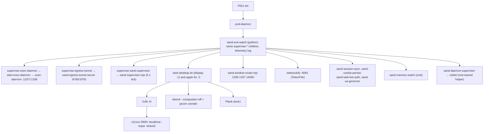
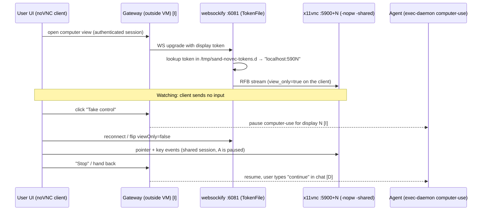
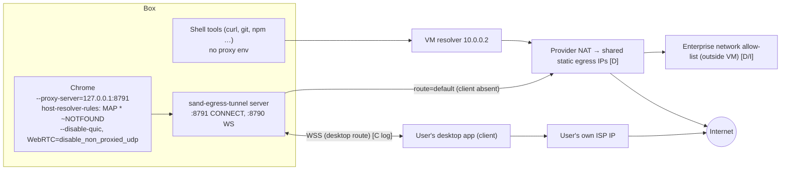
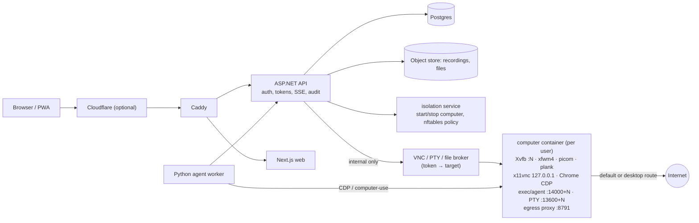

# Bot Computer Architecture (the Grok Bot "box") and how to replicate it in AI Teammates

Scanned: 2026-10-23 (Asia/Karachi), read-only. Nothing on the machine was changed, no other hosts were scanned.
All tokens, bearer values, cookies, keys and non-local IPs are **redacted or not read**. Token files are described by mechanism only.

**Legend** — every claim is tagged:
- **[C]** Confirmed on this machine (process list, `ss`, scripts, config, logs).
- **[D]** Stated in public Cursor/xAI Grok Bot docs (links in section 11).
- **[I]** Inferred (not directly visible from inside the VM). Treat as a design hypothesis.

---

## 1. One-paragraph summary

The "box" is **one Debian 13 (trixie) Linux microVM per user** [C: `/etc/os-release`, kernel 6.12; D: "dedicated Firecracker microVM"], 8 vCPU / 16 GB RAM / 128 GB durable disk [C]. PID 1 is `tini → /pod-daemon`, which launches a small tree of Node/Python/bash supervisors [C]. The VM only **dials out**; users never connect to it directly — a gateway outside the VM brokers every connection (control, VNC, terminal, files, CDP) [I; consistent with D: "apps send each request to Cursor's servers. From there, work runs on the member's hosted computer"]. Each "Bot window" is a separate X display (`:1`, `:3`, …) with its own Xvfb, VNC server, Chrome, exec-daemon and PTY, all reachable through two routers (a **window router** for the exec daemon and a **token websockify** for noVNC) [C]. All browser traffic leaves through a local **egress tunnel** (HTTP CONNECT proxy on loopback) that can exit either from the shared datacentre IPs or from the user's own desktop [C+D]. There is **no Cloudflare/Tailscale/WARP software running on the box** [C]; Cloudflare appears only as the *Web Bot Auth* request-signing standard [C: header names `Signature-Agent` / `Signature-Input`; I: that this is Cloudflare's/IETF Web Bot Auth].

> Note: this VM *also* hosts Saad's own AI Teammates docker-compose stack (Caddy on 18080/18443, bridges `br-*`, veth*). Those are **not** part of the box product; they are listed separately in §4.

---

## 2. System map

```mermaid
flowchart LR
  subgraph User["User side"]
    UI["Desktop / mobile app (UI)"]
    DESK["User desktop app\n(egress tunnel client)"]
  end

  subgraph Cloud["Provider cloud (outside the VM)"]
    CP["Control plane + auth\n(api2…)"]
    GW["Per-user gateway / reverse proxy\n(*.cursorvm.com, nested host) [I]"]
    NET["Network policy + shared static egress IPs [D]"]
  end

  subgraph VM["User microVM (Debian 13, Firecracker) [C/D]"]
    direction TB
    POD["tini → pod-daemon (PID1) [C]"]
    WR["sand-window-router :1339 [C]"]
    ED1["exec-daemon :1337 / PTY :1338\n(display :1)"]
    EDN["exec-daemon :14000+N / PTY :13600+N\n(forked display :N)"]
    WS80["websockify :6080 → x11vnc :5900 (no token)"]
    WS81["websockify :6081 (TokenFile) → x11vnc :5900+N"]
    X["Xvfb :N 1920x1200 + xfwm4 + picom + Plank"]
    CH["Chrome CDP :9222+N, kiosk/maximized"]
    TUN["sand-egress-tunnel\nWS :8790 / CONNECT proxy :8791 (loopback)"]
    SUP["sand-supervisor, exit-watch,\nmemory-watch, orbitd"]
    DISK[("/workspace on durable disk")]
  end

  UI -->|HTTPS/WSS| CP
  UI -->|HTTPS/WSS: VNC, PTY, files, CDP| GW
  GW --> WR --> ED1
  WR --> EDN
  GW --> WS81 --> X
  GW --> WS80 --> X
  ED1 --> DISK
  EDN --> CH
  CH -->|--proxy-server loopback:8791| TUN
  TUN -->|default| NET
  TUN <-->|WSS :8790 via gateway, "desktop route"| DESK
  SUP -. restarts / telemetry .-> X
  POD --> SUP
```

---

## 3. Boot and process tree [C]



Patterns worth copying [C]:
- Every long-running process is wrapped by `box-bounded-log` (bash + `flock` + a Node log trimmer) so logs can never fill the disk.
- Each component has a **supervisor with exponential backoff and restart-window limits** (`supervise-exec-daemon`, `supervise-egress-tunnel`, `sand-supervisor-desktop`), writing JSON telemetry lines (`exec_daemon_restart`, `egress_tunnel`, `boot_stage`) to `/tmp/sand-box-telemetry.log`.
- Two cgroups, `interactive` (desktop, Chrome) and `agent` (exec-daemon), same CPU weight, so a runaway agent cannot freeze the live view.
- The exec-daemon is started with `oom_score_adj=-1000` so the OOM killer prefers Chrome.
- `box-doctor` self-test checks: machine-id validity, Chrome version, Chrome open-file-descriptor ratio (fail ≥ 90 %), egress to `generate_204`, clock skew vs. the HTTP `Date` header (fail > 60 s), D-Bus, X display readiness.
- Host-side scripts are shipped as a **versioned "host bundle"** (`/opt/sand/sand-host`, scripts synced into `/usr/local/bin`), so the box can upgrade without re-imaging. Port numbers are generated from one contract (`box-contract.generated.mjs`, `// @generated SignedSource`) into JS and bash so they never drift.

---

## 4. Ports, processes and roles [C unless noted]

### 4.1 Box-product ports

| Port | Bind | Process | Role |
|---|---|---|---|
| 1337 | all | exec-daemon (display :1) | Primary agent API: shell exec, file ops, computer-use, MCP meta tool. Static dev token `local`; reachable only via gateway [I] |
| 1338 | all | exec-daemon | PTY websocket (terminal) |
| 1339 | all | sand-window-router | Routes by header `x-sand-display`: display ≤ 1 → 1337, else → 14000+N after checking `x-sand-window-owner` against a bound token file (constant-time compare). Else 403 |
| 1340 | all | node (host gateway) | "hostGateway" per `box-contract`; internal host↔box channel [C contract; I role] |
| 14000+N / 13600+N | all | exec-daemon/PTY for forked display N (here 14003 / 13603) | Per-window exec + terminal |
| 5900 / 5900+N | **127.0.0.1** | x11vnc `-localhost -nopw -shared -forever -noxdamage` | VNC server per display. No password and **no `-viewonly` flag** |
| 6080 | all | websockify + noVNC web client → 5900 | Plain, **token-less** proxy for the primary display |
| 6081 | all | websockify `--token-plugin TokenFile` | Multi-display noVNC proxy: the client connects with a token and websockify looks up the target `host:port` in `/tmp/sand-novnc-tokens.d` |
| 8790 | all | sand-egress-tunnel server | WebSocket endpoint where a remote *tunnel client* (the user's desktop) attaches |
| 8791 | **127.0.0.1** | sand-egress-tunnel server | HTTP CONNECT proxy that Chrome uses |
| 9222+N (here 9225) | **127.0.0.1** | Chrome `--remote-debugging-port` | CDP for display N (display :1 → 9223, :3 → 9225). `--remote-debugging-address=127.0.0.1` |
| 9400+N | 127.0.0.1 | box-external-view relay | Fake CDP endpoint that forwards to a remote browser WSS (see §7) |
| 9600 | 127.0.0.1 | box-tailnet-chrome | CDP of the optional private-network ("tailnet") browser. Not running now |

### 4.2 Other long-running pieces

| Process | Role |
|---|---|
| `Xvfb :N -screen 0 1920x1200x24 -ac +extension GLX +render -noreset` | Virtual screen. 16:10, same ratio as the 1280×800 `--computer-use-api-width/height` the exec-daemon exposes to the model, so the model's coordinates scale linearly [C+I] |
| `xfwm4 --compositor=off` + `picom --backend xrender` | Window manager + light compositing (no GPU) |
| `plank --name dock1` | Bottom dock. dconf: position bottom, theme Transparent, icon-size 48, hide-mode window-dodge; launchers = Chrome, Thunar, xfce4-terminal. No panel, no desktop icons |
| `sand-wallpaper paint` (hsetroot) | Paints a tone-matched PNG chosen from `~/sand-data/settings.json` (variants `a/b/c`), fallback JPG, fallback solid `#1e2330` |
| `google-chrome-stable` (see §6.3) | The agent's and user's browser |
| `sand-supervisor.mjs` | 5 s tick; host-bundle upgrade logic; probes forked-display VNC with an RFB 003.008 handshake (security type None) and kills/restarts after N failures; restarts desktop components with backoff |
| `sand-exit-watch`, `sand-memory-watch` | Exit reasons and memory pressure telemetry |
| `orbitd` (own user, via `sand-daemon-supervisor`) | Privileged helper reachable by the exec-daemon over a unix socket (`--orbitd-proxy-socket`) |
| `sand-session-sync`, `sand-cookie-persist`, `link-chrome-session` | Persist Chrome session cookies across VM recreation (works around Chrome keeping session cookies in memory only) |
| `sand-web-bot-auth`, `sand-ua-governor` | Browser identity: request signing + UA/fingerprint coherence (§6.3) |
| `cursor-agent-store-fuse` | FUSE mount of the agent store (`/cursor/stores/…`) |
| `browser-use`, `shadcn` MCP servers | Child processes of the primary exec-daemon: MCP servers launched on the box (this is how "plugins" can run locally) [C] |

### 4.3 NOT part of the box product (Saad's stack running on this VM)

`18080`/`18443` (Caddy), `2375`, `50052`, `26500`, Docker bridges `br-*` and `veth*`, 14 containers' NAT (Docker-managed iptables only; all chains ACCEPT). `/workspace/ai-teammates-live/cloudflared.log` shows Saad ran his **own** `cloudflared` quick tunnel earlier; it is not running now [C].

---

## 5. How the user interacts with the box

### 5.1 Functions the box exposes [C = visible on box, D = documented]

| User-visible function | How it works on the box | Evidence |
|---|---|---|
| **Watch** the computer | UI opens noVNC (served from `/usr/share/novnc`) over the gateway to websockify → x11vnc → Xvfb. Client is in **view-only** mode | C (stack), D ("Watch the computer"), I (view-only mode) |
| **Take control** | Same VNC session switched to read-write input; bot's computer-use actions are paused for the duration ("Watching" ↔ "Take control" pill) | D, I |
| **Terminal** | PTY websocket (1338 / 13600+N) from exec-daemon, tmux shipped in `/exec-daemon` | C |
| **Files** | `/workspace` on the durable disk (`/dev/vdb`), served by exec-daemon file APIs; upload/download tools move files between user machines and the box | C (disk) / D |
| **Browser** | Chrome with CDP on loopback; used by Playwright/browser-use/MCP and by computer-use screenshots | C |
| **Computer use** | exec-daemon flags `--computer-use-enabled --computer-use-lazy-init --computer-use-api-width 1280 --computer-use-api-height 800`; `sand-x11-driver` (1 MB native binary) injects mouse/keyboard | C flags, I driver role |
| **Recordings / Teach a task** | exec-daemon bundle references `ffmpeg` heavily (63 hits) and `recording` (170 hits); docs: Teach records up to 10 min of the visible screen, no microphone | C (strings), D, I (mechanism = ffmpeg x11grab) |
| **Plugins / MCP** | MCP servers are spawned as children of exec-daemon (`browser-use`, `shadcn` seen); `--mcp-meta-tool-enabled` | C |
| **Shell approvals / Auto Review** | Not implemented on the box (no approval code found in scripts). It sits in the provider backend, which gates tool calls before they reach exec-daemon | D, I |
| **Sign-in hand-off** | Bot never types passwords; user takes control and signs in; session cookies persist (sand-cookie-persist) | D, C |
| **Reset / Recover / hibernate** | Durable disk survives; VM recreated from last saved data | D |

### 5.2 Watch → Take control flow



How **view-only vs read-write** is enforced: x11vnc runs with **no `-viewonly`** and no password, and noVNC's `rfb.js` has a native `viewOnly` property (it filters pointer/keyboard on the client) [C]. So on the box, read-only is **not** a server-side guarantee; the strong guarantee must come from the gateway (e.g., issue a view-only token that maps to a read-only proxy, or refuse input frames) [I]. Replicate it with a proxy that drops client→server RFB message types 4/5 (KeyEvent, PointerEvent) for the watch role.

### 5.3 noVNC token mechanism (no values shown) [C]

- `/tmp/sand-novnc-tokens.d/` holds one tiny file per display. File name = the token; content = one line `token: host:port` (the standard websockify `TokenFile` format).
- `start-desktop.sh` writes that file when `SAND_NOVNC_TOKEN` is set in the environment (the host injects it at window creation); otherwise it starts a plain websockify without tokens (this is the `:6080` primary path).
- websockify reads the directory on every connection, so adding/removing a file instantly grants/revokes a route with no restart.
- On this box the tokens are **short routing keys**, not strong secrets. Security therefore relies on the network position: the gateway is the only party able to reach 6081 [I]. Do not copy that detail; use random ≥128-bit tokens with a TTL if the port is ever reachable by users.
- Second token directory: `/tmp/sand-window-tokens.d/` binds a window owner token to a display for the **window router** (header check, `timingSafeEqual`) [C].

---

## 6. IP, DNS, egress and Cloudflare

### 6.1 Egress flow



Confirmed facts [C]:
- Chrome is started with `--proxy-server` pointing at the loopback CONNECT proxy and `--host-resolver-rules="MAP * ~NOTFOUND , EXCLUDE localhost , EXCLUDE 127.0.0.1 , EXCLUDE ::1"`. Chrome therefore **never does DNS itself**; hostnames are resolved by whoever terminates the tunnel. That avoids DNS leaks and makes the browser look like it lives where the exit IP is.
- Shell traffic (`curl` etc.) has **no proxy variables** and uses the VM's resolver `10.0.0.2` and the default route (direct NAT). So browser and shell can have different exit IPs.
- `/tmp/sand-egress-tunnel-client` marker exists and `egress-tunnel.log` shows `route="desktop"`, `fail_closed=false`, `desktop connect` / `desktop disconnect … grace_s=90` and `client attached to a vacant tunnel session`. Meaning: a client on the user's desktop attaches over the WS port, there's a 90 s grace window on disconnect, and with `fail_closed=false` the box falls back to the normal route when no client is attached. A marker `/tmp/sand-egress-tunnel-fail-closed` switches to fail-closed [C contract].
- Fingerprint hygiene markers set at boot: `webrtc-proxy-only`, `no-local-dns`, `disable-quic`, `browser-egress-timezone`, `accept-language-en-us`, `coherent-fingerprint`, `hardware-profile`, GPU mode (`swiftshader`). `sand-egress-timezone.mjs` looks up the exit IP's country/timezone via two public geo APIs (ipinfo, ipwho.is), and the browser timezone/locale is set to match. `sand-ua-governor` overrides UA/WebGL/canvas via CDP so they are internally consistent. `--disable-blink-features=AutomationControlled` is set.
- iptables (read-only view): Docker chains only; default policies ACCEPT. So the VM itself does not enforce an egress allow-list [C]. Enterprise "Network Controls" therefore live outside the VM (gateway/NAT) [D+I], and apply to running computers "within about a minute" [D].
- **No** `cloudflared`, `warp-cli`, `tailscale`, `wg` binary or process exists on the box [C].
- **TEAMS-ISO**: the string does not occur in any box script or `/etc` file [C]. It is probably a dashboard/plan label or the ISO 27001/42001 certification referenced in the docs [D]; treat as unverified. A team-managed setup exists: `/opt/sand-managed/assignment.json` + `sand-team-converge.mjs` (Team Setup Scripts: manifest-driven installs, secrets envelope with reserved env prefixes `SAND_`, `LD_`, `__CURSOR`). Contents were **not** read.

### 6.2 "Tailnet" / private network path [C code, not provisioned now]

- `box-tailnet-chrome` launches a **second Chrome** (CDP 9600) whose profile, home, downloads and XDG dirs live in a **RAM-only tmpfs** at `~/tailnet`; it refuses to start if that folder is not tmpfs, or if the box is an "untrusted-turn clone" (exit 75).
- `sand-tailnet-mount` (root, Python) mounts that tmpfs race-free (`O_NOFOLLOW` dir fd + `mount --no-canonicalize`); `sand-tailnet-wipe` clears it; a host list `/var/lib/sand/tailnet/host-suffixes` tells the everyday browser to **block** private-network hostnames so they can only be opened in the tailnet browser.
- The route to the private network itself is host-side (no VPN client in the VM). Docs: Tailscale/Cloudflare-Tunnel recipes are for Cloud Agents; for Grok Bot you route through the member's desktop or install your own client via Team Setup Scripts [D].

### 6.3 Cloudflare relevance

- **Web Bot Auth** [C code, I standard]: `sand-web-bot-auth.mjs` enables the CDP `Fetch` domain on Chrome and adds `Signature-Agent` and `Signature-Input` (+ signature) headers to outgoing requests, with a 120 s signed-header cache (`/tmp/sand-web-bot-auth-signed.json`, max 64 entries) and signature sources `fresh | box_cache | fleet_cache`. This is the IETF/Cloudflare "Web Bot Auth" idea: well-behaved bots **prove who they are** so sites behind Cloudflare/Akamai don't bounce datacentre traffic. The signing key is not on the box (fresh signatures come from a fleet service) [I].
- Because exit IPs are shared datacentre ranges, sites flag them [D]; mitigations are: signed requests, fingerprint coherence, and routing through the user's home IP.
- For **user → box** access there is no Cloudflare in the VM; the public edge is the provider's gateway [D: `*.cursorvm.com` nested hostnames, TLS-inspecting proxies must be exempted].

### 6.4 External view (remote cloud browser inside the desktop) [C]

`box-external-view start N` reads one JSON line `{connectUrl: wss://…, liveViewUrl: https://…}` on stdin, then:
1. opens a Chrome **kiosk** window (WM class `sand-external-view`) on display N showing a 36 px status bar + an iframe of `liveViewUrl` (CSP restricted to https/loopback);
2. starts a relay on `127.0.0.1:9400+N` that serves a fake `/json/version` whose `webSocketDebuggerUrl` is `/devtools/browser/external`, and pipes that WebSocket to the remote `connectUrl` (through the egress proxy unless loopback), max 8 connections, rejects any request with an `Origin` header or non-loopback `Host` (DNS-rebinding defence);
3. accepts `{kind:"navigate", liveViewUrl}` commands and reports `disconnected`; restarts the viewer once.
Result: the agent's CDP tools drive a remote hosted browser while the user's VNC view shows its live view. Exit codes: ok 0, failed 1, usage 64, unavailable 69, busy 73.

---

## 7. How the user's UI connects [mostly I]

1. UI authenticates to the provider control plane (account SSO) → gets session.
2. UI asks for the user's computer; the control plane wakes/starts the microVM if hibernated (D: "idle computers hibernate").
3. UI opens separate WebSockets through the gateway: chat/events (control plane), noVNC (→ 6081/6080), PTY (→ 1338 or 13600+N), exec/file/computer-use requests (→ 1339 → 1337/14000+N), screenshots/CDP as needed.
4. The VM itself only has **outbound** connections (pod-daemon uses a vsock SSH-agent socket; orbitd/host bundle fetched from a gateway). `ss` shows no remote client directly attached to 6080/6081 other than local relays [C].
5. Mobile and desktop apps use the same flow; "Route traffic through this computer" starts the tunnel client in the desktop app and attaches to the WS port (§6.1) [D+C].

---

## 8. What the desktop looks like (matches the screenshot) [C]

Debian 13 · Xvfb 1920×1200×24 · xfwm4 (compositor off) + picom xrender · **Plank** bottom dock (3 icons: Chrome, Thunar, Terminal; Transparent theme; 48 px; window-dodge hide) · no panel / no desktop icons · dark-grey swoosh wallpaper via `hsetroot -cover` · GTK file-chooser sized 1100×680 at (90,60) · default browser forced to `box-chrome.desktop`. The "Watching | Take control" pill and the rounded 16:10 frame are in the **web UI**, not the VM [I].

---

## 9. Security design notes (what to copy, what not to) [C]

- Secrets are scrubbed from children: `start-desktop.sh` unsets the gateway token and tunnel bearer from its env **and from any env var whose value contains them**; Chrome and the exec-daemon are launched with those unset (`env -u …`). A unix socket `sand-identity.sock` (mode 0600) provides identity instead of env tokens.
- Everything runs as non-root user `box`; root-only helpers (`orbitd`, memory-watch, tailnet mount) are separate small programs.
- Chrome runs `--no-sandbox` (VM is the sandbox), `--password-store=basic`, with managed policies for WebRTC (`disable_non_proxied_udp`) and force-installed WebAuthn/1Password extension shims.
- Ports 6080/6081/1337/1338/8790 bind on `0.0.0.0` with weak/no auth. This is safe only because the VM has no inbound route from the internet. **Do not copy that**: in Docker, publish nothing and authenticate at the API.
- Window forks are cross-checked: `x-sand-window-owner` must equal the token bound to that display, else 403.

---

## 10. How to replicate in AI Teammates

Current state (from `src/services/computer`): Debian trixie-slim, Xvfb at **1024×768**, openbox + tint2 + pcmanfm, x11vnc, noVNC on 6080, a small in-container agent on 7700, compose services `caddy, web, api, agent, computer-image, docker-proxy, isolation, postgres, object-store`, Caddy routes `/api/*`, `/api/events`, `/vnc/*` to the API. This is already structurally close. Gaps and steps, in priority order. Effort = one developer, includes tests.

| # | Step | Concrete work | Effort |
|---|---|---|---|
| 1 | **Match the desktop** | Replace openbox/tint2 with `xfwm4 --compositor=off` + `picom --backend xrender` + `plank` (dconf: bottom, Transparent, 48 px, window-dodge; 3 launchers); Xvfb `1920x1200x24`; `hsetroot` wallpaper (our own swoosh PNG); set `DISPLAY_GEOMETRY`/`SCREEN_*` env; computer-use API size 1280×800 with coordinate scaling ×1.5 | 1–1.5 d |
| 2 | **One generated port contract** | `contracts/box-contract.json` → generated TS/C#/bash/py constants (like `box-contract.generated.mjs`). Bases: exec 14000+N, pty 13600+N, vnc 5900+N, cdp 9222+N | 0.5 d |
| 3 | **Multi-window per computer** | `start-window N` / `stop-window N` scripts: own Xvfb `:N`, x11vnc `-localhost`, Chrome with `--remote-debugging-port=9222+N`, agent worker; cap with `MAX_WINDOWS`; one window per bot | 2 d |
| 4 | **VNC broker with roles** | In ASP.NET API: `/vnc/{botId}?role=watch|control` → issues a short-lived (≤60 s), single-use, random 128-bit token. Tiny websockify-style proxy (can be a Go/Node sidecar or `websockify --token-plugin` reading a tmpfs dir that the API writes through the isolation service). **Watch role: drop RFB client messages 4 (Key) and 5 (Pointer)** server-side, not only in the UI; control role passes everything. Keep x11vnc on `127.0.0.1`, no published ports | 2 d |
| 5 | **Take-control state machine** | `computer.mode` = `bot | user` per window, stored in Postgres + SSE event; when `user`, agent worker refuses computer-use actions ("paused") and the working row shows "You're in control"; Stop returns to `bot`. Audit each switch in the existing AuditChain | 1.5 d |
| 6 | **Window router** | Small proxy in the container (or in API) that maps `X-Display` + owner token → port, constant-time compare, 403 otherwise. Needed only if one container hosts several windows | 1 d |
| 7 | **Supervisors + health** | s6 already exists: add backoff/restart-window limits, `box-bounded-log` equivalent (logrotate or Node trimmer), RFB handshake probe (`RFB 003.008`, security type None, ServerInit read) every 5 s, cgroup `interactive` vs `agent` weights, `box-doctor` script exposed at `/internal/computer/{id}/doctor` | 2 d |
| 8 | **Egress tunnel** | Per-computer HTTP CONNECT proxy on `127.0.0.1:8791` (Go/Rust/Node). Chrome flags: `--proxy-server`, `--host-resolver-rules="MAP * ~NOTFOUND , EXCLUDE localhost , EXCLUDE 127.0.0.1"`, `--disable-quic`, WebRTC policy. Two exits: **default** (Docker NAT, optional per-tenant allow-list enforced in the `isolation` service/nftables on the Docker bridge) and **desktop route** (a client in the companion app opens a WSS to the API, which splices CONNECT streams; 90 s reconnect grace; `fail_closed` flag). Align browser TZ/locale to exit-IP geo | 4–5 d |
| 9 | **Network policy** | Per-team allow-list (domains + CIDR:port) applied at the egress proxy and, for raw TCP, at an nftables set on the compute bridge; show "blocked by policy: add host" errors | 2 d |
| 10 | **Terminal + files** | PTY websocket per window (node-pty or `ttyd`) reachable via API proxy with the same token scheme; file API under `/workspace` with upload/download, path jail, size limits | 2 d |
| 11 | **Recordings / Teach** | Per-window `ffmpeg -f x11grab -framerate 5 -i :N` (VP9/H.264, 10 min cap, no audio) → object-store; Teach banner state in UI; on stop post "The recording is finished. Learn the task from it." with the file attached | 2 d |
| 12 | **Browser identity (optional)** | Implement Web Bot Auth signing in API (Ed25519 key per tenant, publish `/.well-known/http-message-signatures-directory`), CDP `Fetch.enable` hook in the worker adds `Signature-Agent`/`Signature-Input`/`Signature`; UA/WebGL coherence | 2–3 d |
| 13 | **Private network (optional)** | Tailnet-style second browser with RAM-only profile (`tmpfs`), host-suffix block-list in the normal browser; route via the desktop route or an operator-supplied WireGuard/Tailscale sidecar | 3 d |
| 14 | **Public edge** | Keep Caddy; add `cloudflared` (named tunnel, outbound only) or Cloudflare proxy in front for TLS/WAF; WebSocket idle timeouts ≥ 100 s need heartbeats (websockify `--heartbeat=30` is the reference). Don't publish 6080/5900 | 0.5–1 d |
| 15 | **Approvals / Auto Review** | Keep in API: tool-call gate with Allow once / Always / Deny, relayed to all chats (already in V0.4 messaging); rules stored per user | existing |

Total for 1–11 ≈ 18–20 dev-days; 12–14 optional ≈ 6–7 days.

Suggested compose layout:



---

## 11. Sources

Machine (all read-only): `/usr/local/bin/{box-contract.generated.mjs, box-x11vnc, box-doctor, box-external-view*, box-tailnet-chrome, box-chrome, box-chrome-policy, start-desktop.sh, start-window, supervise-*, sand-window-router.mjs, sand-supervisor*.mjs, sand-web-bot-auth.mjs, sand-egress-timezone.mjs, sand-wallpaper, sand-tailnet-*}`, `ss -tlnp`, `ps`, `ip`, `/proc/<pid>/cmdline` of Chrome/exec-daemon (secret values stripped), `/tmp/egress-tunnel.log`, `/tmp/sand-box-telemetry.log`, `/usr/share/novnc`.

Public docs:
- Security FAQ: https://cursor.com/docs/grok-bot/security-faq
- Security (network policy, static egress IPs, approvals, local execution): https://cursor.com/docs/grok-bot/security
- Work with Grok Bot (watch, take over, files, Teach a task): https://cursor.com/docs/grok-bot/work
- Connect to private networks: https://cursor.com/docs/grok-bot/private-networks
- Settings (route traffic through your desktop): https://cursor.com/docs/grok-bot/settings.md
- Use the computer and apps: https://docs.x.ai/grok-bot/computer-and-apps

## 12. Not verified / open questions

- Exact gateway hostnames and how the provider's edge authenticates WebSockets (only docs hint: `*.cursorvm.com`).
- Where view-only is enforced in the real product (client flag vs. gateway).
- Recording implementation (ffmpeg presumed) and the `sand-x11-driver` internals (binary).
- Contents of `/opt/sand-managed/assignment.json`, secrets files and token files were intentionally **not** read/printed.
- "TEAMS-ISO" not found on the box.
