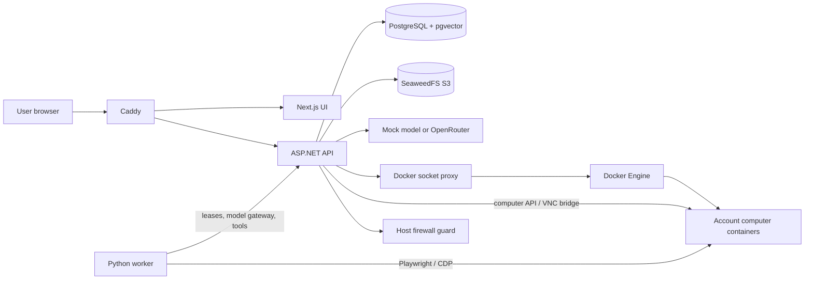

# Teammates repository guide

Source review: 2026-10-25, commit `0a8a3fa` on `main`.
The checked-out `main` baseline has 280 tracked files and approximately 32,000 lines
across C#, Python, TypeScript/TSX, SQL, and protobuf. This guide describes that
baseline only. The repository also has 52 remote branches; see
[`GIT_BRANCH_GUIDE.md`](GIT_BRANCH_GUIDE.md) for the branch graph, feature inventory,
and the much fuller `origin/ui-integrate` snapshot. This is an architecture and
onboarding reference, not a completed security audit or proof that the deployed
stack works.

## Orientation

Teammates is a self-hosted web workspace for bots with conversations, persistent
Linux computers, browser automation, files, memory, reusable skills, and routines.
The code includes private-beta account roles/invitations and v0.3 plugin/recovery
features despite older version labels in the README, web package, and Updates UI.

The central design is a .NET application that owns application state and authorizes
actions, plus a Python worker that orchestrates model/tool turns. Computers are
Docker containers managed by the API. Next.js is the browser client. PostgreSQL is
the durable application store; SeaweedFS stores artifact objects.



Normal execution does not use gRPC or a Go compute service. The protobuf contract
and generated C# bindings describe a future compute boundary. `Program.cs`
constructs `DockerComputeProvider` directly; `FakeComputeProvider` is for tests.

## Stack and build boundaries

| Area | Checked-in technology | Main boundary |
|---|---|---|
| Web | Next.js 15, React 19, TypeScript 5, Tailwind 3, Radix/shadcn components | `apps/web/package.json` |
| API | ASP.NET Core `net10.0`, Npgsql 10, Dapper, AWS S3 SDK | `apps/api/Teammates.Api.csproj` |
| Compute | C# domain interface, Docker.DotNet | `src/Compute.*` |
| Worker | Python 3.12 image, httpx, Playwright 1.49.1 | `services/agent/Dockerfile` |
| Computer | Debian trixie, s6-overlay, Xvfb, Openbox, tint2, Chromium, x11vnc, FastAPI | `services/computer/Dockerfile` |
| Persistence | PostgreSQL 17 with pgvector; SeaweedFS S3 | `docker-compose.yml`, `db/` |
| Edge | Caddy 2.10 | `Caddyfile`, `deploy/Caddyfile.production` |
| Tests | xUnit, pytest, Playwright 1.55 | `tests/` |

There is no root Node workspace or .NET solution. Build/test commands target project
files or individual application directories. `global.json` pins SDK `10.0.402`
with `latestFeature` roll-forward. The web has a package lock; Python dependencies
are installed in Dockerfiles rather than a root Python package manifest.

## Source map

| Files / directory | Responsibility |
|---|---|
| `apps/api/Program.cs` | Startup, dependency construction, migrations, exception responses, maintenance loop |
| `apps/api/Platform.cs` | Database/S3 access, sessions, secrets, audit append, bot placement, recovery callbacks, event publication |
| `apps/api/Routes.cs` | Core public routes, files/memory/skills/routines/artifacts, internal worker protocol, SSE, VNC websocket bridge |
| `apps/api/Runtime.cs` | Model gateway, policy gate, tool dispatch, questions, artifacts, task-step recording, outbound reconciliation |
| `apps/api/ToolSchema.cs`, `ProviderWire.cs` | Built-in tool schemas and validation; internal/OpenAI transcript conversion and usage parsing |
| `apps/api/Beta.cs`, `Access.cs` | Invitations, account roles/status, quotas, user computer actions, bot edits/deletion, notifications |
| `apps/api/Security.cs`, `Policy.cs`, `Dlp.cs`, `SecurityRoutes.cs` | Password/secret crypto, policy classes and decisions, redaction, deny rules, policy routes |
| `apps/api/LoginBroker.cs`, `LoginFlow.cs`, `LoginRateLimiter.cs` | Temporary encrypted login fields, login form lifecycle, saved credential grants, rate limiting |
| `apps/api/PluginModel.cs` | Installed plugin records, credential/kind aliases, basic CRUD |
| `apps/api/PluginManifest.cs` | Manifest validation, registry parsing/deduplication, OpenAPI/Swagger extraction, SSRF checks, risk derivation |
| `apps/api/PluginCatalog.cs` | Catalog routes, install/enable/connect/call, OAuth, tool discovery, import/check/health jobs |
| `apps/api/PluginCli.cs` | `plugins import`, `check`, `stats`, `add-openapi` command mode |
| `apps/api/V03.cs` | Compact tool index, risk labels, outbound ledger, recovery rules, stdio planning, mock OAuth, limited YAML parser |
| `apps/api/BotFs.cs`, `stdio_wrap.py` | Per-bot execution identity/workspace helper; stdio subprocess resource limits |
| `apps/api/Reactions.cs`, `AuditChain.cs`, `SseLog.cs`, `TaskSignal.cs`, `HostBudget.cs` | Reaction transactions/feedback, audit hashes, event replay ring, lease wakeups, host defaults |
| `src/Compute.Domain` | Compute records/interfaces/errors, redaction, idempotency and operation gates, disk/power rules |
| `src/Compute.Docker` | Container lifecycle, exec streaming, desktop tokens, metrics, disk setup, restore, idle suspension, firewall checks |
| `src/Compute.Fake` | In-process compute model, simulated files/lifecycle/exec, fake secret and snapshot stores |
| `contracts/` | Future compute protobuf service, buf configuration, generated-binding project |
| `services/agent/worker.py` | Long-poll leasing, heartbeats, transcript persistence, model/tool loop, deterministic skill replay |
| `services/agent/browser.py` | Worker-side Playwright connections and browser tools over CDP |
| `services/agent/guard.py`, `run_guard.py`, `plugins.py` | Tool-output scrubbing, untrusted-content markers, run limits, enabled plugin checks |
| `services/computer/src/server.py` | Token-protected desktop/browser/file/control API on port 7700 |
| `services/computer/src/desktops.py` | Persistent desktop descriptions; dynamically supervised X/WM/Chrome/VNC services |
| `services/computer/src/browser.py` | Computer-local browser control, live-origin credential checks, cookies, confined shell |
| `services/computer/src/workspace.py`, `pure.py` | Bot UID/directory provisioning, path containment, filesystem helpers, pure redaction/origin helpers |
| `services/computer/src/cdp_proxy.py` | Public-to-container-local DevTools HTTP/websocket proxy with host and URL rewriting |
| `services/computer/s6`, `scripts`, `desktop` | Computer startup/service dependencies and desktop launchers/configuration |
| `services/computer/fixtures`, `sample-repo`, `fixtureserver.py` | Bundled portal/security pages, MCP echo process, intentionally broken coding exercise |
| `services/mock-openrouter` | OpenAI-shaped deterministic model server and finite prompt-to-plan fixtures |
| `apps/web/app` | App Router pages: home, bot, login/invite, settings, system, UI gallery |
| `apps/web/components` | Shell/workspace/chat/computer plus feature panes and shared UI primitives |
| `apps/web/lib` | Fetch/error handling and normalization, event stream, message blocks, shared types/theme/status utilities |
| `deploy/`, `scripts/`, `evals/` | Compose overlays, edge/firewall configuration, installation/backup/low-end tools, opt-in real-model eval |

## Request and task lifecycle

1. Login verifies a PBKDF2-SHA256 password. A random session cookie is issued;
   PostgreSQL stores its SHA-256 hash with a 14-day server expiry.
2. Bot creation inserts a bot, a default `Desk` conversation, and a control lock.
   The first bot creates the account computer and `user_computers` mapping. Later
   bots normally reuse that computer. Placement retains a legacy per-bot fallback.
3. `POST /api/conversations/{id}/messages` checks ownership and strict-data policy,
   stores the message, creates a queued task, publishes an event, and pulses workers.
   Ordinary chat also creates a task; it gets priority 10 versus work priority 0.
4. The worker calls `/internal/tasks/lease`. An advisory transaction lock and
   `FOR UPDATE SKIP LOCKED` coordinate task selection. Tasks get a 20-second lease,
   incrementing epoch and attempt, placement/CDP information, feedback, and saved
   skill steps when applicable. Empty leasing waits up to 20 seconds for a pulse.
5. Each worker task heartbeats every 5 seconds. It loads the saved task transcript
   or starts with the generic system prompt and this task's instruction.
6. The API model gateway resolves `secret://openrouter/default`, redacts prompt
   content, converts the internal transcript into OpenAI chat-completions format,
   and records model requests, usage, latency, and cost.
7. Browser tools are authorized by the API and then run directly by the worker
   over CDP. Results return through `/internal/tools/observe`. Other tools run
   through `/internal/tools/execute` and `Runtime.Dispatch`.
8. Approvals and human questions/login/CAPTCHA/takeover suspend execution. The
   owner's action requeues the task. Unanswered tool calls in the stored transcript
   allow the worker to resume the pending operation.
9. Completion updates the task, inserts a nonempty assistant reply, creates a
   notification, and publishes a refresh event. Expired running leases are requeued
   by maintenance; worker startup also reclaims its old running leases.

The worker handles parallel tool calls from the provider by executing their
pending calls sequentially and retaining their IDs. Limits are 12 model rounds,
24 tool steps, 90 seconds checked at tool boundaries, and a repeated-call guard.
These are not a hard wall-clock timeout around every HTTP retry.

## Data ownership and persistence

| Domain | Tables / storage |
|---|---|
| Identity | `users`, `sessions`, `invitations`, `user_quotas` |
| Bot placement/control | `bots`, `user_computers`, `control_locks`, `browser_pages`, `seen_domains` |
| Conversation/task | `conversations`, `messages`, `tasks`, `task_transcript`, `task_steps` |
| Human interaction | `approvals`, `login_prompts`, `secret_requests`, `notifications` |
| Learning/reuse | `memories`, `skills`, `routines`, `routine_runs`, `bot_feedback`, `message_reactions` |
| Credentials/policy/audit | `secrets`, `secret_usage_events`, `credential_domain_grants`, `user_policies`, `policy_deny_rules`, `audit_events`, `audit_chain_head` |
| Plugins | `plugins`, `plugin_catalog`, `plugin_bot_enable`, `plugin_oauth_states`, `plugin_import_state`, `plugin_jobs` |
| Model accounting/outbound | `model_requests`, `model_calls`, `outbound_actions` |
| Files | Computer Docker volumes; per-bot roots beneath `/data/workspace/bots/{guid-without-hyphens}` |
| Artifact bytes | SeaweedFS S3; metadata/checksum/object key in `artifacts` |
| Snapshots | API snapshot volume through `DirectorySnapshotStore` |

Migrations `001` through `010` run at API startup from `/migrations`, copied into
the API image. Migration tracking is custom SQL rather than an ORM. The original
`connectors` table becomes `plugins` in migration 005 with a compatibility view.
Some original tables, such as login-share bundle records, remain in the schema
without a complete product flow.

Files, browser profiles, and application records have different ownership:
the account shares one browser/desktop, while shell/file tools get distinct bot
UIDs and mode-0700 workspace directories. `/workspace` is a logical bot-relative
path for these tools. Browser cookies/tabs are shared account state.

## Feature details

- **Memory:** text plus normalized 64-dimensional local token hashes. Retrieval
  orders by PostgreSQL full-text rank and vector distance, returning five results.
  Saving/forgetting adds structured notices to chat. It is not a hosted embedding
  model or automatic conversation summarizer.
- **Skills:** successful task steps become saved JSON. Login steps can include
  vault references. Replay runs steps without model calls; it does not re-plan.
- **Routines:** five-field cron via the local `Cron` parser. Routes and maintenance
  use UTC despite a timezone schema field and browser-local timezone preference.
  HTTP/memory watch fingerprints skip model work when unchanged or unavailable.
  Overlap avoidance currently checks queued/running/planning routine tasks.
- **Artifacts:** the active saver decodes bytes as UTF-8, redacts text, and stores
  `text/plain`. Do not assume arbitrary binary/media preservation.
- **Reactions:** one reaction per actor/message; repeat removes, a different emoji
  replaces. User reactions to assistant messages become feedback on a later lease
  and do not independently start work.
- **Questions:** structured `ask_user` cards persist in messages. Answers update
  the card and transcript using the original tool-call ID, then resume the task.
- **Notifications/PWA:** database notifications plus browser permission/preferences;
  the service worker only installs/activates. No offline cache or web push flow.

## Policy, credentials, and trust boundaries

Policy defaults allow reads/writes and ask for deletes, sending, public posting,
payments, signing, and credential use. Hard-deny rules, strict-data scanning,
legacy shell/browser checks, user policy, credential domain grants, and optional
model-assisted classification feed `PolicyGate`. Model classification can make
a decision stricter. These mechanisms are largely heuristic and do not establish
a general proof against prompt injection or arbitrary shell behavior.

Secrets use AES-256-GCM with random nonces and associated data containing secret
ID, owner ID, type, and key version. References use `secret://namespace/name`.
Resolution checks owner, revocation, expiry, allowed tools/bots, and destination
when supplied. The API receives the master key; workers/computers do not.
The worker has a service token, and computers receive a separate computer token.

Login forms send field values directly to the API. `LoginBroker` temporarily
encrypts them in process with a short TTL; plaintext values are not stored in
`login_prompts`. Optional saving goes through the vault. Computer-local filling
checks the current page/frame origin before entering credentials and returns
status rather than field values.

The audit writer serializes appends with an advisory lock and a SHA-256 hash chain.
Database triggers prohibit ordinary updates/deletes of audit and secret-usage rows.
This provides application-level tamper evidence, not protection from a privileged
database operator capable of altering the schema/triggers.

## Plugin lifecycle

1. Import official-registry pages, add a manifest, or generate from OpenAPI/Swagger
   JSON or the supported YAML subset. Validation/deduplication creates catalog rows.
2. Structural checks and bounded remote probing update check labels/status.
   Importing does not install a process. Health probes can hide unhealthy tools.
3. A user explicitly installs a catalog entry, connects credentials when needed,
   and enables the installation for selected bots.
4. Model prompts get a compact tool index plus `search_tools`/`load_tool` discovery.
   The returned schema is reconstructed from metadata/path placeholders; it does
   not preserve every original MCP/OpenAPI input schema. The model tool list is
   not dynamically extended with loaded functions by the worker.
5. Invocation rechecks installation, bot enablement, catalog health, policy, and
   credential access. Remote MCP/OpenAPI calls run from the API; stdio commands
   run inside the bot computer under its UID and a resource-limited wrapper.

Remote plugin requests use scheme/host/IP/DNS checks, disabled redirects, and
bounded response reads. Stdio supports a restricted command-launcher set and
CPU/address-space/file-size/open-file/time budgets. These are specific controls;
the wrapper is not an independent VM or comprehensive network sandbox.

Catalog jobs poll every 15 seconds. Optional scheduled imports are off by default;
health work is queued every 15 minutes. CLI operations need database configuration
and are separate from starting the web server. General third-party OAuth support
is limited: the current exchange lacks a full client-registration/PKCE/refresh flow.

## Compute, recovery, and networking

The Docker provider implements lifecycle operations, streamed exec, metrics,
desktop sessions, and snapshots. Labels allow discovery after API restart;
operation locks/idempotency caches, tombstones, and desktop tokens are in memory.
Do not confuse those caches with the durable outbound ledger.

`outbound_actions` tracks selected sends/posts/plugin writes/payments/file deletes.
It replays completed results, avoids blindly repeating uncertain effects, and
uses maintenance reconciliation to inspect evidence. Deletes additionally use
claims and file-state checks. This is not a universal exactly-once guarantee;
shell effects are not comprehensively ledgered and argument JSON is hashed as
provided rather than fully canonicalized.

Missing computer containers can be recreated from persistent volumes. Tasks wait
with `computer_recovering` and resume through callbacks/maintenance once usable.
The default idle mode stops computers after inactivity to reclaim RAM; pause and
reclaim modes also exist. Default quotas are 640 MiB RAM, 0.40 CPU, 64 MiB shared
memory, and a 64 MiB `/tmp`; account disk default is 10 GiB. Host memory selects
two or three computers unless overridden.

Disk limits use a fixed-size ext4 image in a Docker volume. Formatting uses the
computer image; mounting uses a temporary privileged helper with the host PID/
mount namespace. This is a host-integrated Linux deployment, not an unprivileged,
portable container stack. Data-volume quotas and optional rootfs storage limits
are distinct.

| Network / endpoint | Members and purpose |
|---|---|
| `front` | Caddy, web, API |
| `teammates-back` (internal) | API, worker, Postgres, S3, mock model |
| `teammates-computers` (`172.30.28.0/24`) | Account computers, API `.10`, worker `.11`; computer internet egress |
| `teammates-dockerctl` (internal) | API and Docker socket proxy |
| Public dev ports | Caddy `18080` HTTP, `18443` HTTPS |
| Test-only host port | API `127.0.0.1:18081` through test overlay |
| Computer private ports | API `7700`, proxied CDP `9222` to local `9223`, VNC view `5900`, control `6900`, fixtures `8099` |

The host-network isolation guard repairs `TEAMS-ISO` firewall rules through a Unix
socket and periodic checks. The API checks it before lifecycle starts when the
isolation socket is configured. The checked-in rules reject computer TCP/UDP to
RFC1918 ranges except trusted API/worker source addresses; they are not a complete
IPv4/IPv6 egress policy. The regular Caddyfile routes API/health/VNC while keeping
internal API paths and metrics off the public API proxy.

Desktop access uses short-lived tokens and fencing epochs. The API bridges browser
websockets to private VNC TCP ports. View and control servers are separate;
read/write VNC starts on takeover. The frontend serializes noVNC socket teardown
and reconnect, including phone visibility/touch/keyboard handling.

## Frontend organization

`AppShell` owns the roster/sidebar, creation, notifications, command palette, and
navigation. `Workspace` loads the selected bot's snapshot and mounts feature panes.
`ChatPane` handles messages, assignment, reactions, structured questions/forms/media.
`ComputerPane` is dynamically imported without SSR and manages noVNC/control UX.
Other panes handle files, artifacts, memory, tasks, skills, routines, and plugins.

State uses local React hooks and shared types rather than a central store. API
normalizers tolerate snake/camel aliases. `subscribeEvents` uses streaming fetch
so reconnects can set `Last-Event-ID`, pauses on hidden tabs, and reconnects online.
SSE events trigger debounced refetches; a 15-second poll backs them up. The server
has a 200-event in-memory ring, not a durable event bus or token-streaming reply UI.
Preferences are mainly in localStorage. The locale choice changes the document
language; it does not provide a complete translation system.

## Running and verification

Normal setup is `bash scripts/install.sh`, then Docker Compose. Inspect the install
script first: it creates the master key and changes host firewall forwarding.
The production overlay requires a non-default owner password and disables test
hooks; public hostname/TLS, all other credentials, and the mounted SeaweedFS S3
configuration still need operator configuration. Compose does not inject every
`.env` entry into every service.

| Command | What it exercises / requires |
|---|---|
| `make test-unit` | .NET unit tests and Python tests; SDK/NuGet and pytest/httpx needed |
| `dotnet test tests/compute-contract/Compute.ContractTests.csproj --nologo` | Fake compute contract by default |
| `make test-contract` | Fake and real Docker compute contracts; Docker/image/privileges needed |
| `make test-integration` | Changes running Compose API/Caddy services and runs acceptance/security/isolation/recovery tests |
| `make test-e2e` | Installs E2E npm deps and runs Chrome desktop/phone scenarios against a running stack |
| `make test-lowend` | Alters cgroups/container limits and then runs the full suite |
| `make eval-real` | Opt-in real provider call, vault write/rotation, bot/tasks, and billable model usage |
| `cd apps/web && npm ci && npm run build` | Frontend dependency install and production build; fonts also use Next's Google-font loader |

CI lints/breaking-checks protobuf conditionally, runs C# and Python unit suites,
and fake compute contracts. It does not build/test the web application or boot
the real Docker stack. Many Python tests are static source/config assertions;
passing them does not validate runtime firewall, VNC, or quota behavior.

Checks actually performed during this review:

- Full Python unit suite: **46 passed**. System Python initially lacked `httpx`;
  the final run used existing cached pure-Python dependencies through `PYTHONPATH`.
  No packages were installed and no project dependency files were changed.
- `docker compose config --quiet`: passed.
- Shell syntax checks for install/backup/restore/low-end/CLI/isolation/proxy scripts: passed.
- AST parse of all 41 baseline Python files and JSON parse of all 20 baseline JSON
  files: passed. The sample calculator is intentionally logically incorrect.
- .NET unit invocation: blocked before compilation because installed SDK
  `10.0.113` does not satisfy pinned `10.0.402`.
- Docker daemon inspection: permission denied. Real compute/integration/E2E,
  frontend build/typecheck, buf checks, and real-provider eval were not run.

The successful Python command in this session was:

```sh
PYTHONPATH=/home/saad/.cache/uv/archive-v0/hxT1XmJClHKX0jzc/lib/python3.12/site-packages \
PYTHONDONTWRITEBYTECODE=1 python3 -m pytest -q -p no:cacheprovider tests/unit
```

The cache path is machine-specific; normal development should supply dependencies
in an appropriate Python environment. Makefile also contains old `/home/ubuntu`
and `/workspace` paths that need care on other hosts.

## Gaps and follow-up investigation

These are source observations, not runtime reproductions. No fixes were made.

| Observation | Evidence / consequence |
|---|---|
| Bot role/instructions/model settings are stored, but not incorporated into the active worker/model request | `worker.py` starts a generic prompt plus task instruction; `Runtime.Model` uses global `Platform.ModelName`. Full conversation history is not automatically injected either. |
| Outbound delivery has placeholders | `Runtime.SendMessage` inserts an assistant message locally; `external_post` returns `delivered=false, held=true`; built-in plugins echo metadata. |
| SSE is globally broadcast after session authentication | `Platform.Publish` sends every payload to every sink; `/api/events` does not filter by owner. Reaction payloads include message/actor identifiers and emoji. |
| Some worker mutations lack full lease fencing | Transcript PUT deletes/replaces rows without checking its supplied epoch; model completion has no epoch check. Most execution/completion paths do check epochs. |
| Saved-skill creation checks the destination bot but not the source task's ownership | `Routes.cs` queries steps and vault refs by supplied `taskId` alone. Cross-account source-task authorization needs a focused test/fix. |
| Shared computer takeover spans more than per-bot state | DB locks are per bot, desktop control has one fence, and worker browser calls use CDP directly. Validate sibling-bot behavior during takeover/replay; skill browser steps currently bypass `_authorize`/`_observe`. |
| Approval binding is coarse | `ConsumeApproval` matches task/tool and consumes separately; it does not compare the approved argument payload. |
| Scheduled import job detail read omits parameters | `PluginCatalogJob.RunOne` queries `WHERE id=@id` for import detail without passing `id`; investigate the import-job path. |
| Logout clears the browser cookie but retains the DB session | `Routes.cs` logout does not revoke the session hash. |
| Resource contract exceeds enforced container fields | `ResourceLimits.MaxPids` exists, but `BuildCreate` does not set Docker `PidsLimit`. |
| Operational documentation is missing from this reconstruction | README references `docs/SECURITY.md`, `docs/PERFORMANCE.md`, `docs/V0_2_PLAN.md`; these are absent. `make test-desktop-speed` references absent `tests/perf/desktop-speed.mjs`. |
| Backup coverage is partial | `backup.sh` dumps PostgreSQL and checks key exclusion; complete recovery also requires the separate master key, S3 data, computer volumes, and relevant snapshots. |

## Where to change things

| Intent | Starting points and relevant verification |
|---|---|
| Add an application tool | `ToolSchema`, `Runtime.Dispatch`, policy classification; worker browser allowlists if relevant; schema/policy/worker tests |
| Change model context/provider behavior | `worker.py`, `Runtime.Model`, `ProviderWire`, provider fixtures and parallel-call tests; opt-in real eval only when authorized |
| Add a public endpoint | `Routes`, `Beta`, `SecurityRoutes`, or `PluginCatalog`; explicit ownership/role checks plus integration tests |
| Add persistent data | Next numbered SQL migration, `Platform.MigrateAndSeed`, API Dockerfile migration copy, matching Dapper queries/types |
| Change compute or disk behavior | Domain + Docker + Fake implementations, contract scenarios, recovery/resource tests |
| Change desktop/control behavior | `desktops.py`, computer server/browser, compute desktop session authority, API bridge, `ComputerPane`, VNC/mobile tests |
| Change credential/policy behavior | API security/login/runtime, computer live-origin checks, Python guard; wrong-owner/domain/lease/injection tests |
| Change plugin support | Manifest parsing + catalog invoke + policy risk + UI; registry/OpenAPI fixtures and plugin integration tests |
| Add UI behavior | App page / feature pane, shared types/API normalizers, appropriate desktop/mobile Playwright scenario |
| Deploy or tune resources | Compose/overlays, firewall guard, provider defaults, HostBudget, static budget tests and real host validation |

Review classification: architecture, data flow, ownership/trust boundaries, and
verification inventory were REQUIRED NOW; durable onboarding notes were RECOMMENDED
NOW. Behavioral fixes, deployment, production hardening, and paid real-model eval
are DEFERRED until those tasks are requested. New distributed infrastructure and
an architectural rewrite are NOT APPLICABLE to this understanding pass.
